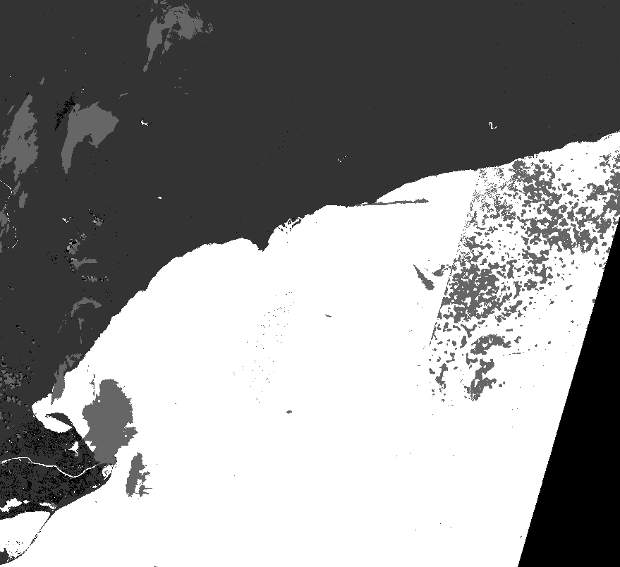
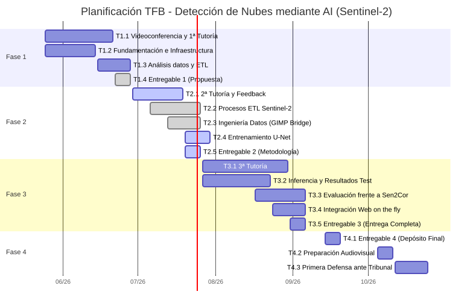
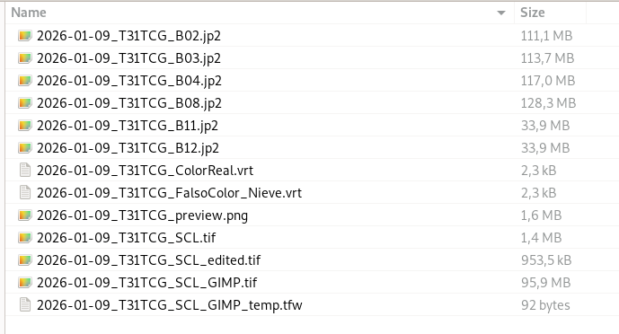
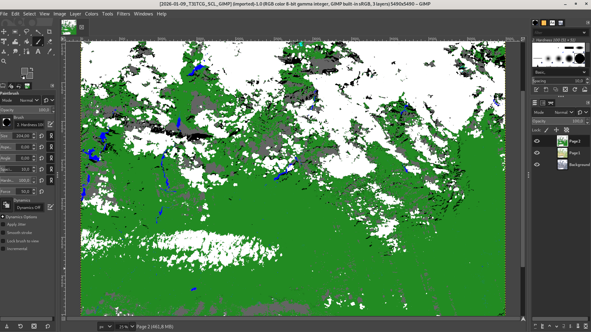
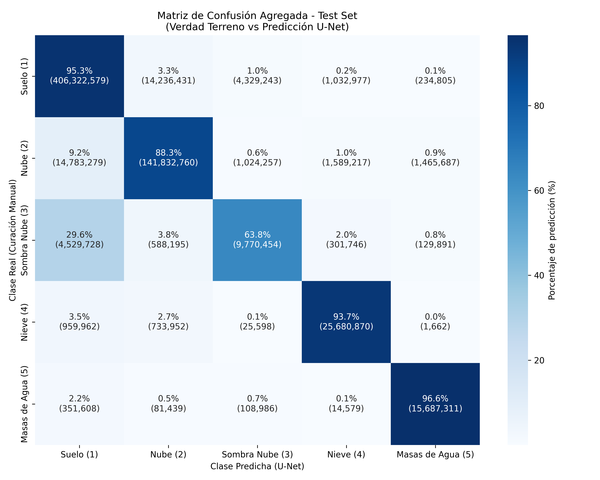
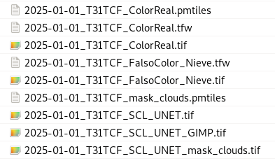
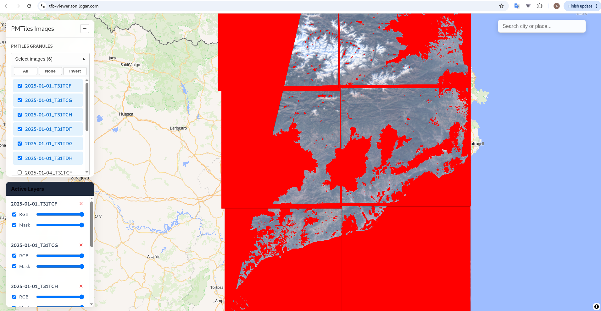

<div style="text-align: center; margin-top: 50px; margin-bottom: 30px;">
    
</div>

<h1 align="center" style="font-size: 2.5em; margin-bottom: 10px;">Trabajo Final de Grado (TFB)</h1>
<h2 align="center" style="color: #FFC000; font-size: 1.8em; margin-bottom: 40px;">Desarrollar un entorno web geoespacial escalable para imágenes Sentinel-2, diseñado para utilizar un modelo de Machine Learning</h2>

<div align="center" style="font-size: 1.4em; line-height: 1.6; margin-bottom: 40px;">
  <strong>Autor:</strong> Antonio López<br>
  <strong>Tutor/a:</strong> Favela Natalie Quintero Chona<br>
  <strong>Fecha:</strong> 31/08/2026 - 20/09/2026
</div>

<div align="center" style="font-size: 1.2em; margin-bottom: 20px;">
  <strong>Página web del proyecto:</strong> <a href="https://tonilogar.github.io/tfb/tfb.html">tonilogar.github.io/tfb</a><br>
  <strong>Repositorio y control de versiones:</strong> <a href="https://github.com/tonilogardev/web_basic_project/tree/main_dev_pro_tfb/011_tfb">GitHub - Master Roadmap</a><br>
  <strong>Aplicación Web (Web GIS):</strong> <a href="https://tfb-viewer.tonilogar.com/">tfb-viewer.tonilogar.com</a>
</div>

<div style="page-break-after: always;"></div>

## Resumen  

El objetivo de este trabajo es el desarrollo de una infraestructura modular base para proyectos geoespaciales. Los módulos serán agnósticos al software, entornos, sistemas operativos o librerías utilizadas; esta base será escalable y replicable para futuros proyectos.  
La infraestructura se divide en 4 módulos:  

1. Buscar, descargar y procesar datos geoespaciales; en el caso de estudio se utilizará la API OData del Copernicus Data Space Ecosystem (CDSE) para bajar las imágenes Sentinel-2 de la constelación Copernicus.  
2. Editar y clasificar manualmente los datos necesarios para el entrenamiento supervisado del modelo; en el caso de estudio se utilizará GIMP para crear la verdad del terreno **"Ground Truth"** a partir de los ficheros de clasificación de la ESA.   
3. Preparar los datos para el entrenamiento y el test del modelo U-Net de deep learning; en el caso de estudio se comparan los resultados del modelo con los resultados del algoritmo del software Sen2Cor de la ESA.  
4. Construir un entorno Web GIS para la visualización de los resultados; en el caso de estudio se utilizará un entorno con contenedores Docker, Svelte para el frontend, la librería cartográfica MapLibre GL y el formato PMTiles para visualizar los resultados.  


**Palabras clave:** *Deep Learning, Sentinel-2, U-Net, Copernicus.*

<br><br>

## Abstract

The objective of this work is to develop a modular base infrastructure for geospatial projects. The modules will be agnostic regarding the software, environments, operating systems, or libraries used; this foundation will be scalable and replicable for future projects.  
The infrastructure is divided into four modules:  

1. Searching for, downloading, and processing geospatial data; in the case study, the Copernicus Data Space Ecosystem (CDSE) OData API is utilized to download Sentinel-2 imagery from the Copernicus constellation.  
2. Manually editing and classifying the data required for supervised model training; in the case study, GIMP is used to create the "ground truth" based on ESA classification files.  
3. Preparing data for training and testing the U-Net deep learning model; in the case study, the model's results are compared with those produced by ESA's Sen2Cor software algorithm.  
4. Building a Web GIS environment to visualize the results; in the case study, an environment featuring Docker containers, Svelte for the frontend, the MapLibre GL mapping library, and the PMTiles format is employed for result visualization.

**Keywords:** *Deep Learning, Sentinel-2, U-Net, Copernicus.*

<br><br>

<div style="page-break-after: always;"></div>

## Índice interactivo

- [Glosario de Términos](#glosario-de-términos)
- [1. Introducción](#1-introducción)
- [2. Justificación](#2-justificación)
- [3. Contextualización clasificación de píxeles](#3-contextualización-clasificación-de-píxeles)
- [4. Objetivos generales y específicos](#4-objetivos-generales-y-específicos)
  - [4.1. Objetivo general](#41-objetivo-general)
  - [4.2. Objetivos específicos](#42-objetivos-específicos)
- [5. Marco teórico y conceptos clave para una arquitectura U-Net](#5-marco-teórico-y-conceptos-clave-para-una-arquitectura-u-net)
  - [5.1. Datos espaciales: Sentinel-2 y el espectro electromagnético](#51-datos-espaciales-sentinel-2-y-el-espectro-electromagnético)
  - [5.2. Estrategia de Datos y Decisiones Arquitectónicas](#52-estrategia-de-datos-y-decisiones-arquitectónicas)
  - [5.3. Bibliografía Científica Base (Core References)](#53-bibliografía-científica-base-core-references)
- [6. Metodología aplicada](#6-metodología-aplicada)
  - [6.1. Fase 1: Ingesta de datos y orquestación (*Pipeline ETL*)](#61-fase-1-ingesta-de-datos-y-orquestación-pipeline-etl)
  - [6.2. Fase 2: Ingeniería de Datos y Verdad Terreno (*Ground Truth*)](#62-fase-2-ingeniería-de-datos-y-verdad-terreno-ground-truth)
  - [6.3. Fase 3: Entrenamiento y Evaluación del Modelo (*Deep Learning*)](#63-fase-3-entrenamiento-y-evaluación-del-modelo-deep-learning)
  - [6.4. Fase 4: Despliegue en infraestructura Web GIS](#64-fase-4-despliegue-en-infraestructura-web-gis)
- [7. Desarrollo viable y sostenible](#7-desarrollo-viable-y-sostenible)
  - [7.1. Temporalización e hitos](#71-temporalización-e-hitos)
  - [7.2. Alineación con los ODS y Códigos UNESCO](#72-alineación-con-los-ods-y-códigos-unesco)
  - [7.3. Condicionantes ambientales, sociales y económicos](#73-condicionantes-ambientales-sociales-y-económicos)
- [8. Proceso y resultados](#8-proceso-y-resultados)
  - [8.1. Pivotes Arquitectónicos](#81-pivotes-arquitectónicos)
  - [8.2. Resultados Finales de la Evaluación](#82-resultados-finales-de-la-evaluación)
- [9. Discusión y limitaciones](#9-discusión-y-limitaciones)
- [10. Conclusiones y líneas futuras](#10-conclusiones-y-líneas-futuras)
- [11. Referencias Bibliográficas](#11-referencias-bibliográficas)

<div style="page-break-after: always;"></div>

## Glosario de Términos

Para facilitar la lectura a evaluadores y personas no especialistas en Sistemas de Información Geográfica (GIS) se definen los siguientes términos clave utilizados en este documento:

- **Sentinel-2:** Misión de satélites ópticos de alta resolución de la constelación copernicus.
- **Sen2Cor:** Software de la Agencia Espacial Europea (ESA) para la corrección atmosférica (incluye un detector de nubes básico que este proyecto pretende mejorar).
- **Tiling:** Técnica geoespacial que consiste en "trocear" imágenes satelitales gigantes en cuadrados más pequeños para que el ordenador pueda procesarlos sin saturar la memoria RAM.
- **OOM:** *Out of Memory* (Fuera de memoria). Colapso del ordenador por intentar cargar demasiados datos gráficos a la vez.
- **COG:** *Cloud Optimized GeoTIFF*. Formato de imagen satelital optimizado para ser consultado y procesado de forma rápida y directa en la nube.
- **PMTiles:** Formato de archivo de mapa diseñado para almacenar teselas geoespaciales de forma estática sin necesidad de crear servidores cartográficos dedicados en backend.
- **gpkg:** *GeoPackage*. Formato de base de datos geoespacial open source.
- **shp:** *Shapefile*. Formato de archivo informático vectorial clásico y muy extendido para almacenar sistemas de información geográfica.
- **On the fly:** Procesamiento o renderizado en tiempo real. Siendo ejecutado dinámicamente por el backend sin necesidad de procesarlo en el servidor de la herramienta.
- **ESA:** *European Space Agency* (Agencia Espacial Europea).
- **ACA:** Agencia Catalana del Agua.
- **ICGC:** Instituto Cartográfico y Geológico de Cataluña.
- **DEM:** *Digital Elevation Model* (Modelo Digital de Elevaciones). Representación en 3D del relieve terrestre.
- **U-Net:** Arquitectura de red neuronal convolucional diseñada para la segmentación semántica de imágenes (asignación de clases píxel a píxel).
- **Ground Truth:** (Verdad Terreno). El patrón o mapa de referencia perfecto que se usa para entrenar al modelo de *Machine Learning*. En este proyecto se ha construido y auditado manualmente.
- **L1C / L2A:** Niveles de procesamiento de imágenes satelitales. L1C es la imagen "cruda" tal cual llega del espacio, y L2A es la imagen tras aplicarle correcciones atmosféricas.
- **IoU:** *(Intersection over Union)*. Métrica matemática utilizada en *Machine Learning* para evaluar el porcentaje exacto de acierto espacial al predecir la forma de un objeto.
- **Recall:** (Exhaustividad). Métrica estadística que mide la capacidad del modelo predictivo para encontrar y señalar todas las nubes reales que existen en la imagen sin dejarse ninguna.
- **VRAM:** Memoria de acceso aleatorio de vídeo. Es la memoria exclusiva de las tarjetas gráficas (GPUs), la cual se colapsa al cargar imágenes espaciales inmensas si no se emplea el Tiling.
- **NDSI:** *(Normalized Difference Snow Index)*. Índice matemático que resalta la reflectancia de la nieve frente a las nubes altas basándose en la luz infrarroja.

<div style="page-break-after: always;"></div>

# 1. Introducción

El programa Copernicus, de la Agencia Espacial Europea (ESA), es una constelación de satélites que proporcionan diferentes datos para la observación de la Tierra. Desde Sentinel-1 (datos radar) y Sentinel-2 (datos ópticos), hasta Sentinel-3 (datos de temperatura), entre otros.
En este trabajo se pretende crear un metodo modular para poder solucionar problemas cartograficos, con modelos de machine learning, y poder representarlos en una plataforma web gis. En esta caso en concreto detectar nubes en imagens satelitales para después mostrarlas en una plataforma web gis. Para ello se utilizarán los datos de Sentinel-2.  
Sentinel-2 es una misión compuesta por dos satélites (Sentinel-2A y Sentinel-2B) que proporcionan imágenes ópticas multiespectrales de alta resolución. Los satélites capturan información en 13 bandas espectrales. Su resolución espacial va desde 10 m en el espectro visible y el infrarrojo cercano, las bandas de 20 m proporcionan rangos especializados como el Red Edge, el infrarrojo cercano estrecho (Narrow NIR) y el infrarrojo de onda corta (SWIR) y las bandas de 60 m capturan la información atmosférica exclusiva (aerosoles, vapor de agua, nubes y cirros) para proporcionar datos para las correcciones atmosféricas y obtener datos de reflectancia real. 
Gracias al desfase orbital de sus dos satélites, ofrece una resolución temporal de 5 días sobre Cataluña. Los datos de estos satélites son fundamentales para la observación de la Tierra, lo que permite el seguimiento continuo de fenómenos globales, como el control de la agricultura de precisión, la predicción, detección y prevención de desastres naturales, entre otros.

Uno de los productos derivados de estas observaciones es el mapa de clasificación de píxeles (producto SCL), generado mediante el procesador estándar de la ESA (Sen2Cor). 
Dado que es un procesador estándar y está hecho para abarcar todo el mundo, no tiene en cuenta las peculiaridades geográficas y el contexto espacial de las distintas regiones. Por esta razón, el algoritmo comete fallos de clasificación al enfrentarse a geografías complejas y heterogéneas. Para solucionar estas limitaciones, se entrenará un modelo, para el territorio de Cataluña, capaz de interpretar el contexto espacial.
A continuación se muestra la clasificación que genera el algoritmo estándar Sen2Cor:

**Leyenda producto SCL:**
- **0**: Sin datos (*No Data*)
- **1**: Píxeles saturados o defectuosos
- **2**: Áreas oscuras
- **3**: Sombras de nubes
- **4**: Vegetación
- **5**: Suelo desnudo (no vegetado)
- **6**: Agua
- **7**: Sin clasificar
- **8**: Nubes de probabilidad media
- **9**: Nubes de alta probabilidad
- **10**: Cirros finos
- **11**: Nieve o hielo

  
*Figura 1: Ejemplo de mapa de clasificación de píxeles (producto SCL) generado por Sen2Cor.*

<div style=\"page-break-after: always;\"></div>

# 2. Justificación

El problema de la clasificación del algoritmo Sen2Cor es que analiza la imagen punto por punto (píxel a píxel), fijándose únicamente en el color y brillo exacto de cada punto por separado, sin tener en cuenta qué hay a su alrededor. Esta falta de contexto visual hace que el algoritmo clasifique erroneamente pixeles.

En el caso específico de Cataluña, estos fallos en la clasificación de pixeles se detectan en tres casos concretos:  
1: Confunde la nieve con nubes.  
2: Confunde las sombras topográficas como sombras de nubes.  
3: Clasifica aguas profundas con pixeles nodata y zonas de arrozales del delta del ebro con masas de agua o nubes en lugar de pixeles de tierra.  

Pero el aprendizaje profundo (Deep Learning) ofrece una solución. A diferencia de las herramientas de clasificación programaticas tradicionales, las Redes Neuronales Convolucionales (CNN) poseen la capacidad de asimilar el contexto espacial, las texturas y la morfología del entorno. Esto permite al modelo diferenciar una nube de una cumbre nevada basándose no solo en su brillo individual, sino en su geometría y su relación con el territorio físico.

La observación de la tierra es clave para tomar buenas decisiones. Por ejemplo, ayuda a gestionar el agua durante las sequías (algo vital para organismos como el Institut Cartogràfic i Geològic de Catalunya, ICGC) o a controlar la salud de los bosques. Si nos basamos en mapas satelitales que tienen errores, terminaremos tomando decisiones equivocadas. Con el modelo que se entrenara en este trabajao intentaremos mejorar la clasificación de pixeles de las imagenes sentinel 2 en la zona de Cataluña.

<div style=\"page-break-after: always;\"></div>

# 3. Contextualización del problema (El límite de Sen2Cor)


1. **Ambigüedad espectral de la Nieve:** Sen2Cor puede confundir la firma espectral altamente reflectiva de la nieve de alta montaña (Pirineos) con los frentes de nubes gruesas.
2. **Falsos positivos por Sombras Topográficas:** Sen2Cor no trabaja con el modelo del terreno, por lo que a menudo clasifica la sombra oscura de una montaña como sombras de nubes, llenando los valles de falsas sombras de nubes.
3. **Anomalías hídricas (El Delta del Ebro):** Las grandes masas de agua profunda son diagnosticadas erróneamente como sombras o nodata, mientras que los terrenos con alta saturación hídrica (arrozales inundados) son clasificados como masas de agua y en algunos casos también como nubes.

<div style=\"page-break-after: always;\"></div>

# 4. Objetivos generales y específicos

## 4.1. Objetivo general

Construir una arquitectura base que, siendo agnóstica al proveedor de infraestructura, permita la integración modular de modelos de Deep Learning y sus resultados en una herramienta WEB GIS.
Caso de estudio:
Integración de una red neuronal U-Net específica para la detección de nubes sobre Cataluña. 

## 4.2. Objetivos específicos

1. **Construir una infraestructura de datos replicable (Pipeline ETL):** Desarrollar un flujo automatizado de extracción, transformación y carga (ETL) que abarque: la descarga de imagenes sentinel 2 L1C y la extracción de las máscaras de clasificación SCL generadas por Sen2Cor. Edición y clasificación manual de dichas máscaras para construir una Verdad Terrestre (Ground Truth) rigurosa, indispensable para el entrenamiento supervisado del modelo con datos de alta calidad.  

2. **Entrenar y evaluar un modelo U-Net:** Diseñar, entrenar y evaluar una red neuronal convolucional orientada específicamente a la segmentación semántica de nubes en la región de Cataluña, acotando el espacio de trabajo a las órbitas R008 y R051 del satélite Sentinel-2.

3. **Analisis comparativo:** Métricas técnicas rigurosas (como Recall e Intersection over Union - IoU) entre tres fuentes:
 

4. **Desarrollar la plataforma Web GIS:** Construir la infraestructura tecnológica web gis necesaria en un servidor web. Trabajar con librerías geoespaciales (MapLibre GL JS y Svelte) para la visualización fluida de cartografía (2D), y servir las inferencias generadas por el modelo en formatos optimizados para la nube (como Cloud Optimized GeoTIFF o PMTiles), demostrando la viabilidad de su integración y consumo de datos en entornos web.


<div style=\"page-break-after: always;\"></div>

# 5. Marco teórico y conceptos clave para una arquitectura U-Net

Reflexiones y decisiones sobre la construcción del modelo y sus datos de entrada.

## 5.1. Datos espaciales: Sentinel-2 y el espectro electromagnético

Para optimizar la capacidad de discriminación del modelo de inteligencia artificial, no se procesa una composición RGB tradicional, sino que se alimenta a la red con un tensor multiespectral estructurado en 7 canales simultáneos:

- **Espectro visible (Bandas 2, 3 y 4):** Azul, verde y rojo. Capturan las texturas físicas, los verdaderos colores de las cubiertas terrestres y las sombras topográficas.  
- **Infrarrojo Cercano o NIR (Banda 8):** Identifica la vegetación (caracterizada por una alta reflectancia en el NIR) y los cuerpos de agua (que absorben esta radiación, presentando firmas espectrales muy oscuras).  
- **Infrarrojo de Onda Corta o SWIR (Bandas 11 y 12):** Fundamental para resolver la ambigüedad espectral de la nieve. Físicamente, las nubes presentan alta reflectancia en el SWIR, mientras que la nieve lo absorbe fuertemente, permitiendo su separación matemática.  
- **NDSI (*Normalized Difference Snow Index*):** Un índice matemático derivado de las bandas Verde y SWIR. Funciona como un canal adicional que inyecta conocimiento físico explícito sobre el comportamiento de la nieve directamente a la red neuronal, facilitando la convergencia del modelo.  

## 5.2. Inteligencia Artificial: La Arquitectura U-Net

Los algoritmos tradicionales evalúan el terreno píxel a píxel sin interpretar su vecindario, este proyecto fundamenta su avance técnico en el **Aprendizaje Profundo (*Deep Learning*)**, concretamente en el campo de la **Visión Artificial (*Computer Vision*)**. La arquitectura convolucional elegida es la **U-Net**, implementada desde cero (*From Scratch*) utilizando el *framework* **PyTorch**, el estándar actual de la industria y la investigación científica.

### 5.2.1. Teoría de Funcionamiento
La arquitectura U-Net (Ronneberger, Fischer y Brox, 2015) es uno de los modelos de Inteligencia Artificial más consolidados para la **segmentación semántica espacial**. Esto significa que la red no se conforma con decir "en esta imagen hay nubes", sino que analiza y decide a qué clase pertenece cada píxel de forma individual, dibujando sus contornos exactos. Su nombre proviene de su estructura matemática en forma de "U", la cual consta de tres mecanismos:     

1. **El Encoder:** A medida que la imagen satelital entra en la red, el modelo le aplica filtros matemáticos y va reduciendo su tamaño progresivamente, como si alejáramos la vista para ver el panorama general. En este proceso, la imagen pierde resolución, pero la red gana comprensión de los patrones generales y texturas. El Encoder aprende a identificar el **"QUÉ"** comprende las características abstractas que diferencian las nubes de las masas de nieve y de las sombras.  

2. **El Decoder:** Es la segunda mitad del proceso. Toma esa información abstracta y altamente comprimida, y la vuelve a ampliar progresivamente hasta recuperar el tamaño original de la imagen (por ejemplo, 512x512 píxeles). Su objetivo es proyectar lo aprendido de nuevo sobre el terreno real; es decir, el Decoder determina el **"DÓNDE"** la ubicación geográfica de esas nubes o nieve.  

3. **Las Skip Connections (Los puentes de detalle):** Existe un problema técnico: al comprimir tanto la imagen en el primer paso y luego expandirla, el resultado final tendería a ser borroso y los bordes quedarían imprecisos. Para evitarlo, la U-Net establece "puentes directos" que conectan las capas iniciales (antes de perder resolución) con las capas finales de reconstrucción. Estos puentes rescatan los detalles nítidos originales y los inyectan en la salida, logrando que la red dibuje las fronteras de los elementos con una precisión a nivel de píxel.  

### 5.2.2. Diseño Arquitectónico y Estructura de Datos (*Data Shapes*)
- **Inferencia (Tratamiento de Entrada y Salida):** Al modelo se le inyecta un tensor espacial de **7 canales simultáneos**. Tras atravesar la "U", el *Decoder* expulsa **6 canales paralelos** (mapas de probabilidad o *logits* correspondientes a las 6 Clases Maestras). Una función de activación matemática (`Softmax`) evalúa cada píxel a lo largo de esos 6 canales y decide estadísticamente qué clase tiene la probabilidad más alta, colapsando el tensor en la imagen 2D final donde cada píxel tiene un valor absoluto del 0 al 5.
- **Entradas (*Inputs - X*):** Su forma matricial es `(N, 7, 512, 512)`. Los tensores están almacenados en disco como `Float16` (reduciendo exactamente a la mitad el peso y acelerando la lectura), pero entran en la red obligatoriamente como `Float32`. Si la IA usara la baja precisión matemática de `Float16` durante el aprendizaje activo, no tendría suficientes decimales para guardar los ajustes microscópicos, redondeándolos a cero y colapsando el entrenamiento.
- **Salidas (*Outputs - Y_pred*):** Su forma es `(N, 6, 512, 512)`, representando los *logits* por Clase Maestra: 0 (Descarte), 1 (Suelo), 2 (Nube), 3 (Sombra Nube), 4 (Nieve), 5 (Agua).

### 5.2.3. Justificación de la programación "From Scratch" frente a redes pre-entrenadas
En este proyecto se tomó la decisión estratégica de programar y entrenar la red U-Net totalmente desde cero (*From Scratch*). Esta decisión se fundamenta en un análisis crítico de laos siguientes puntos:

- **Problemas con los datos de entrada:** Los modelos que ya existen en internet suelen estar diseñados para analizar las 10 o 13 imágenes (bandas) completas que envía el satélite Sentinel-2. En este proyecto, solo se utilizan 7 de ellas. Si se toma un modelo ya entrenado y se le fuerza a usar solo 7 canales cambiándole la "puerta de entrada", se rompe casi todo lo que había aprendido previamente, por lo que deja de tener sentido reaprovecharlo.
- **Problemas con los resultados de salida:** Los modelos genéricos que existen para buscar nubes suelen dar respuestas muy simples: "esto es nube" o "esto está despejado" (sí o no). Este trabajo requiere clasificar 6 elementos muy distintos (nieve, agua, suelo, etc.). Si además de modificarle la entrada (como se vio en el punto anterior) se le cambia la salida para que dé 6 resultados en lugar de 2, el modelo interno se desorienta por completo. Por eso, programar la Inteligencia Artificial desde cero asegura que nazca entendiendo exactamente qué se le va a pedir.
- **Abundancia de Datos y Mitigación del Sesgo Geográfico:** El *Transfer Learning* es una técnica concebida principalmente para paliar la escasez de datos. Sin embargo, el trabajo empleado en la edición y clasificación manual de una Verdad Terrestre (*Ground Truth*) propia gracias a una metodología con el software de imagen opensource "GIMP" permite tener una gran cantidad de datos para entrenar el modelo. Esto asegura que se extraigan los patrones geomorfológicos reales del terreno de estudio, evitando heredar sesgos geográficos o atmosféricos de modelos globales.

### 5.2.4. Evaluación y Función de Pérdida
Para asegurar el correcto aprendizaje de la red neuronal, se han establecido mecanismos matemáticos de corrección y métricas rigurosas:
- **Función de Pérdida (`CrossEntropyLoss`):** Se ha implementado una estrategia crítica de enmascarado (`ignore_index=0`). Las imágenes satelitales a menudo contienen áreas de "NoData" (píxeles nulos fuera de órbita o mares muy oscuros descartados). Al ignorar la clase 0, la función evita penalizar o recompensar a la red en estas áreas nulas, concentrando el 100% de la capacidad de cómputo en la geografía real.
- **Métrica Principal - *Intersection over Union* (IoU):** En teledetección óptica existe un grave riesgo de sesgo por desbalanceo de clases (ej. 95% de cielo despejado frente a 5% de nieve). La precisión global (*Overall Accuracy*) es engañosa, ya que predecir siempre "despejado" daría un 95% de acierto. Para evitar esto, se emplea el índice IoU o de Jaccard por cada clase individualmente, el cual penaliza de forma implacable tanto la sobre-predicción (falsos positivos) como la sub-predicción (falsos negativos).


## 5.3. Estrategia de Datos y Decisiones Arquitectónicas

Este apartado centraliza y justifica las decisiones tomadas en el procesamiento de datos satelitales para entrenar el modelo de segmentación semántica:

### 5.3.1. Nivel de Procesamiento: L1C frente a L2A
**Decisión:** Utilizar imágenes crudas L1C (*Top of Atmosphere*).
**Justificación:** Las nubes se encuentran físicamente en las capas altas/medias de la atmósfera. Aplicar correcciones atmosféricas (L2A) sobre píxeles de nubes no tiene rigor físico. Además, el algoritmo estándar (Sen2Cor) utilizado para generar L2A contiene errores confundiendo nieve con nubes; entrenar el modelo con L2A implicaría heredar este sesgo algorítmico. Operar sobre L1C permite a la red extraer las características físicas puras desde cero, siendo el estándar metodológico en modelos avanzados como *s2cloudless* o *Fmask*.

### 5.3.2. Descarte de Múltiples Modelos por Órbita (R008 vs R051)
**Decisión:** Se entrena un **único modelo** unificado para ambas órbitas relativas.  
**Justificación:** El satélite pasa por Cataluña siguiendo dos rutas distintas en días diferentes, lo que significa que el sol ilumina el paisaje desde distintos ángulos (las sombras apuntan a sitios diferentes). Al mezclar las fotos de ambas rutas en un solo entrenamiento, le enseñamos a la Inteligencia Artificial a reconocer nubes y sombras sin importar de dónde venga la luz del sol. Si hiciéramos un modelo distinto para cada ruta, el modelo se confundiría en cuanto el sol cambiara un poco de posición. Mezclarlo es mas robusto frente a los cambios de iluminación.

### 5.3.3. Descarte de Múltiples Modelos Geográficos (Norte vs Sur)
**Decisión:** Se utiliza un **único modelo** con muestreo estratificado para todo el territorio.
**Justificación:** Crear un modelo exclusivo para el Sur impediría que la red aprendiera sobre la nieve, fallando si ocurriera una nevada atípica en la costa. Exponer al modelo a los "casos más difíciles" simultáneamente (Nieve/Sombras orográficas en el Pirineo y Agua/Agricultura en el Sur) asegura la Generalización del Dominio (*Domain Generalization*), haciéndolo robusto ante datos fuera de lo común.

### 5.3.4. Estrategia de Ingesta: Tiling Directo vs Mosaico Previo
**Decisión:** Realizar el recorte (*tiling* en parches de 512x512) directamente sobre los gránulos MGRS, **descartando el mosaico previo**.
**Justificación:** Unir gránulos de diferentes días genera "costuras" (*seamlines*) con cambios bruscos de iluminación. Las redes convolucionales son muy sensibles a estos bordes artificiales, aprendiendo patrones espectrales que no existen en la naturaleza (ruido de alta frecuencia). Procesar granulos individuales y preserva la coherencia física y evita el colapso de memoria RAM (*Out of Memory*).

### 5.3.5. Composición del Input Tensor
**Decisión:** Tensor multicanal (7 bandas) que prescinde de modelos digitales de elevación (DEM).
**Justificación:** Las bandas Infrarrojas de Onda Corta (SWIR, 20m) son fundamentales, ya que la nieve las absorbe y las nubes las reflejan, haciendo innecesario el uso del DEM. Las bandas Visibles y el Infrarrojo Cercano (NIR, 10m) proveen la alta resolución necesaria para detectar nubes finas. Adicionalmente, el índice NDSI inyecta directamente fronteras de decisión matemáticas a la red neuronal.

### 5.3.6. Descarte de Imágenes de Referencia (Single-Image)
**Decisión:** Se descarta usar una imagen libre de nubes.
**Justificación:** En los Pirineos la nieve es efímera, y en en el Delta del Ebro, las prácticas agrícolas modifican drásticamente la reflectancia del terreno en cuestión de días. Una red multitemporal interpretaría estos cambios bruscos como nubes (alta tasa de Falsos Positivos). La aproximación *Single-Image* evalúa únicamente el estado atmosférico del momento presente, aportando mucha mayor robustez.

### 5.3.7. Descarte de Máscaras Vectoriales de Agua
**Decisión:** No inyectar cartografía estática (lagos o ríos predefinidos).
**Justificación:** En épocas de sequía (ej. embalse de Sau), un mapa vectorial indicará "agua" donde ahora hay tierra brillante. Esta disonancia confundiría severamente a la red. El agua pura ya absorbe el espectro NIR y SWIR casi por completo; la U-Net extrae esta característica hidrológica instantáneamente a partir de los canales espectrales sin depender de cartografía desactualizada.

### 5.3.8. Excepción Teórica: Viabilidad del *Tile* Urbano (Trabajo Futuro)
**Propuesta:** Aunque se descarta como norma general, el uso de "imágenes ideales" sí sería aplicable exclusivamente a parches 100% urbanos.
**Justificación:** A diferencia de campos o montañas, el asfalto y el hormigón urbano mantienen su firma espectral estable durante todo el año. Se podría inyectar la referencia urbana libre de nubes solo tras haber clasificado previamente el parche como "Ciudad". Esta arquitectura híbrida se perfila como una línea futura de investigación para anular los falsos positivos en zonas industriales muy reflectantes.


<div style=\"page-break-after: always;\"></div>

# 6. Metodología

Para la consecución de los objetivos planteados, la metodología de este proyecto se ha estructurado en **cuatro fases estratégicas secuenciales**. Esta arquitectura abarca desde la adquisición automatizada del dato bruto satelital y creación de datos a partir de estos, la construcción manual de un conjunto de datos, el entrenamiento de la Inteligencia Artificial y el despliegue de los resultados en una aplicación Web GIS.

### 6.1. Fase 1: Ingesta de datos y orquestación (*Pipeline ETL*)
Trabajaremos con los datos obtenidos de la ESA y su API para la construcción de un flujo automatizado de Extracción, Transformación y Carga (ETL) capaz de manejar grandes volúmenes de datos geoespaciales. Utilizaremos las herramientas de gdal y librerias python para la manipulación de los datos geoespaciales. En esta primera fase obtendremos los datos, los procesaremos y los almacenaremos en un formato optimizado para el entrenamiento de la red neuronal.
- **Adquisición programática:** Se automatiza la consulta y descarga sincronizada de productos Sentinel-2 (tanto el Nivel L1C para las reflectancias crudas, como el Nivel L2A para recuperar las máscaras de clasificación SCL oficiales generadas por Sen2Cor).
- **Extracción de bandas:** El sistema aísla y apila matemáticamente las 6 bandas multiespectrales de interés (ópticas e infrarrojas), descartando la información redundante.
- **Reducción de dimensionalidad de clases:** Sen2cor divide el terreno en 12 categorías, aportando ruido computacional e ineficiencia. Como pilar metodológico, el *pipeline* geoespacial desarrollado colapsa matemáticamente esas 12 clases originales en **[6 Clases Maestras](008_pixel_legend.md)**: No data, nube, sombra, nieve, vegetación/suelo, agua.  
  
*Figura 2: Comparativa entre las 12 clases originales de Sen2Cor y la reducción a 6 clases para la red neuronal.*    

- **Procesamiento Espacial (*Tiling*):** Un gránulo de Sentinel-2 mide más de 100x100 km, por lo que es imposible cargarlo entero en la memoria VRAM de una tarjeta gráfica. El *pipeline* recorta dinámicamente el territorio en cuadrículas (*tiles*) manejables de 512x512 píxeles, manteniendo intactas sus coordenadas geoespaciales.

### 6.2. Fase 2: Ingeniería de Datos y Verdad Terreno (*Ground Truth*)
Ante la clasificación de fixeles erroneos se genero un conjunto de datos limpio y manualmente a partir de los ficheros SLC de la ESA:  

**Edición y clasificación de la Verdad Terreno (*Ground Truth*):** Para ello, se extrajeron los datos en bruto y se aplicó un proceso de edición y clasificación manual de los píxeles conflictivos mediante el software de edición de imágenes GIMP, permitiendo el análisis manual de una manera cómoda con herramientas de edición de imagen raster como capas, pinceles y gomas para corregir a mano las clasificaciones erróneas basándose en el contexto orográfico real.  

### 6.3. Fase 3: Entrenamiento y Evaluación del Modelo (*Deep Learning*)
Se implementó la arquitectura convolucional U-Net desde cero en PyTorch, diseñando una topología específica para ingerir el tensor de 7 canales formado por las 6 bandas Sentinel más el índice NDSI. 
El entrenamiento se guio utilizando una función de pérdida (*Loss Function*) orientada a penalizar duramente los falsos positivos en zonas de nieve. Posteriormente, el modelo empírico se evaluó contra los resultados estándar de Sen2Cor empleando métricas como el *Intersection over Union* y el *Recall*. En el archivo 011_tfb/013_model_evaluation.py se pueden ver los resultados de las pruebas de evaluación realizadas.

### 6.4. Fase 4: Despliegue en infraestructura Web GIS
El paso final del proyecto consiste en hacer que todo este trabajo matemático sea visual y accesible para cualquier persona a través de internet. Para ello, se ha aplicado una mentalidad DevOps, automatizando y separando los procesos: los mapas resultantes generados por el modelo (el Backend de procesamiento) se conectan directamente a una aplicación Frontend construida con el *framework* Svelte. Para dibujar estos mapas en la pantalla de forma rápida e interactiva, se utiliza la librería MapLibre GL JS. El resultado final es una plataforma Web GIS completa, que demuestra que hoy en día es perfectamente posible servir mapas de satélite de altísima resolución directamente en el navegador del usuario, consiguiendo un sistema ágil, fluido y muy modular.

<div style=\"page-break-after: always;\"></div>

# 7. Desarrollo viable y sostenible

En la era del *Big Data*, el desarrollo de proyectos tecnológicos masivos exige un compromiso íntegro con la sostenibilidad. Este caso de estudio ha sido orquestado bajo tres perspectivas fundamentales de viabilidad y ética: ambiental, social y económica.

## 7.1. Temporalización e hitos

  
*Figura 3: Diagrama de Gantt ilustrando el cronograma general del proyecto.*

1. **Fase 1 - Fundamentación e Ingeniería de Datos:** Conceptualización del problema analítico, evaluación teórica de los sensores de la ESA, viabilidad técnica de los datos y primer planteamiento arquitectónico.
2. **Fase 2 - Arquitectura MLOps y Modelado:** Programación y automatización del flujo de datos ETL masivo para extracción de gránulos vía API. Diseño y colapso de la matriz de características. Refinamiento e investigación del concepto *Ground Truth Humano*. Entrenamiento algorítmico de la red neuronal convolucional (U-Net) y justificación estadística de la pérdida paramétrica. Para garantizar la reproducibilidad científica y técnica, todo el código fuente de esta orquestación se encuentra versionado en un repositorio público de GitHub, estando cada *script* rigurosamente documentado mediante *Docstrings* bajo estándares de ingeniería de *software* profesional.
3. **Fase 3 - Inferencia Cloud y Validaciones:** Ejecución algorítmica sobre un set de Test puro y sin contaminar para su validación científica frente al algoritmo nativo Sen2Cor. Paralelamente, se iniciará el proceso de desacople del modelo para preparar su despliegue en infraestructuras *Cloud*.
4. **Fase 4 - Despliegue Web y Defensas:** Cierre del ciclo tecnológico mediante el desarrollo de una Aplicación Web que servirá el modelo entrenado, permitiendo inferencias *on-the-fly* a nivel de usuario. Culminará con el empaquetado del trabajo escrito y la creación de las defensas argumentativas interactivas.

## 7.2. Alineación con los ODS y Códigos UNESCO

El trabajo se engloba dentro de los siguientes puntos de la agenda 2030.

### Códigos UNESCO

- **1207.94 (Aprendizaje automático):** Justificado por el entrenamiento de un modelo de *Deep Learning* (Redes Neuronales U-Net) para la segmentación semántica de imágenes satelitales.
- **1203.93 (Cloud Computing):** Aplicado en el diseño y despliegue del entorno escalable (*pipeline* geoespacial) y la futura infraestructura del modelo en el servidor web, para utilizarlo de forma automatica con cada imagen sentinel 2 publicada.
- **1203.96 (Bases de Datos):** Requerido para la orquestación y estructuración de la arquitectura orientada a la nube mediante formatos geoespaciales optimizados (*Cloud Optimized GeoTIFF* y *PMTiles*).

### Objetivos de Desarrollo Sostenible (ODS)
El trabajo esta directamente relacionado con los siguientes ods:

- **ODS 9 (Industria, Innovación e Infraestructura):** El proyecto construye una infraestructura geoespacial modular y replicable basada en open source, que puede ser utilizada por cualquier organización para procesar y analizar datos satelitales.
Mejorando el algoritmo de detección de nubes de Sen2Cor en la zona de Cataluña.
- **ODS 13 (Acción por el clima):** El proyecto permite trabajar con modelos de machine learning dentro de un entorno geoespacil y mostrar los resultados en la web.  
En el caso de uso se entrena un modelo para la detección de nubes en una zona en concreto "Cataluña".

## 7.3. Condicionantes ambientales, sociales y económicos

### Condicionantes Ambientales (*Green Computing*)
El entrenamiento de redes neuronales requiere un uso intensivo de tarjetas gráficas (GPU), lo que conlleva un consumo eléctrico elevado. Para reducir este impacto energético durante el desarrollo del proyecto:
- Se aplica la técnica de **Tiling**, que divide las imágenes satelitales en cuadrantes más pequeños. Antes de procesar cada cuadrante, se comprueba si contiene información útil. Si el parche está compuesto principalmente por datos nulos (por ejemplo, zonas de mar abierto o sin cobertura), se descarta y no se envía a la GPU. Esto reduce notablemente el tiempo de cómputo y la energía consumida por el hardware.
- En cuanto a su aplicación práctica, contar con clasificaciones de píxeles fiables resulta de gran utilidad para las instituciones públicas. Por ejemplo, permite a la **Agencia Catalana del Agua (ACA)** realizar un seguimiento más preciso de la nieve en el Pirineo y de las cuencas fluviales en episodios de sequía. De la misma forma, el **Institut Cartogràfic i Geològic de Catalunya (ICGC)** puede generar ortofotos sin nubes con menor esfuerzo manual. Al tratarse de una arquitectura modular, el sistema puede adaptarse en el futuro para procesar datos de otras misiones, como Sentinel-1 o Sentinel-3, lo que abriría la puerta a estudios sobre riesgos de aludes o monitorización de movimientos del terreno.

### Condicionantes Sociales y Replicabilidad Científica (Open Source)
Los errores en los mapas satelitales pueden provocar decisiones equivocadas o tardías en la gestión del territorio. Ofrecer clasificaciones precisas a profesionales, como agricultores o gestores de parques naturales, proporciona información fiable para su trabajo diario. Facilitar el acceso a estos datos permite, a su vez, una respuesta más rápida por parte de la administración pública ante episodios como sequías o incendios forestales.

Para asegurar la **replicabilidad científica**, tanto los datos de la ESA como el código desarrollado en este proyecto son de dominio público (*Open Source*). El proyecto completo está versionado en un repositorio de **GitHub**. Para que la investigación pueda ser revisada y utilizada por otras personas, el código se ha estructurado de forma modular y documentado mediante *Docstrings*. De este modo, cualquier investigador puede clonar el repositorio, entender el funcionamiento del código y reproducir los resultados obtenidos sin coste alguno.

### Condicionantes Económicos
Con el objetivo de que este proyecto pueda ser utilizado sin costes de licencia, el desarrollo se basa completamente en *software* libre:
- Se han utilizado herramientas y lenguajes de código abierto (Python, librerías geoespaciales y el *framework* PyTorch).
- Para la edición manual de las imágenes (creación del *Ground Truth*), se ha empleado GIMP, un programa de edición gráfica libre y gratuito.
- Los datos base se obtienen de forma gratuita a través de la API OData de Copernicus, proporcionada por la Unión Europea.
- El uso del formato PMTiles permite alojar la cartografía resultante en un servidor web estático de bajo coste, reduciendo la necesidad de mantener servidores GIS dedicados y costosos.

<div style=\"page-break-after: always;\"></div>

# 8. Proceso y resultados

Este apartado detalla el trabajo cronologicamente del proyecto y se muestran  los resultados del modelo entrenado frente al algoritmo estándar Sen2Cor.

## 8.1. Pivotes Arquitectónicos
El desarrollo de este proyecto se utilizaron metodologías ágiles de trabajo (similares a *Scrum*). Trabajar de esta manera permite una gran flexibilidad: en lugar de seguir un plan rígido inamovible, el enfoque consistió en ir probando, detectar los fallos rápido y corregirlos sobre la marcha. A lo largo del desarrollo surgieron varios problemas técnicos que obligaron a detener el avance, evaluar la situación y realizar varios cambios de rumbo importantes en la estructura del proyecto:

- **Paso 1. El Estándar (Sen2Cor):** Partiendo de mi experiencia profesional, se tiene conocimiento empírico de que la clasificación de Sen2Cor presenta anomalías de clasificación en áreas geográficas concretas de Cataluña.
Ejemplos:Masas de agua profundas, sombras de relieve, zonas inundadas etc.. .  **Decisión:** Se creo manualmente la clasificación de los pixeles para no heredar errores de los ficheros SCLl de la ESA.  

- **Pivote 2. El Dilema Topográfico:** Para diferenciar las nubes densas de la nieve, en principio se usaria el Modelo Digital de Elevaciones (DEM) de Cataluña. Se descartó su utilización al demostrar el estudio de publicaciones científicas para apostar exclusivamente por la física espectral (bandas SWIR y NDSI). Esto facilito mucho el trabajo pero provocó que el modelo presente debilidades algorítmicas frente a las sombras de las montañas, estableciendo una clara línea de investigación futura.  

- **Pivote 3. El colapso del Delta del Ebro (Clase Masas de Agua):** Durante las primeras épocas de entrenamiento con 5 clases, las inferencias sobre el Mediterráneo y los arrozales del Delta del Ebro clasificaban los pixeles de forma erronea. El sol, al reflejarse especularmente en el mar (*Sun Glint*), cegaba a la red neuronal, haciéndole predecir inmensos bancos de nubes inexistentes y las zonas inundadas se confunden con agua. Se decidio crear una sexta Clase para las Masas de Agua.

- **Pivote 4. API STAC vs API OData:** La ESA cambió hace un par de años su interfaz de acceso a datos hacia el nuevo entorno *Copernicus Data Space Ecosystem (CDSE)*. En principio se iba a usar el protocolo STAC, pero debido a diversos problemas técnicos, se optó finalmente por utilizar la API OData. 
- **API OData (*Open Data Protocol*):** Esta API de mas bajo nivel, permite acceder a la base de datos de la ESA filtrando la búsqueda por el código exacto de la cuadrícula geográfica (*Tile ID*, ej. T31TCH). De este modo, se evitan los problemas de recortes irregulares e intersecciones defectuosas que ocurren al buscar por polígonos en el catálogo.


## 8.2. Proyecto paso a paso:

### 8.2.1. Fuentes de datos y recopilación
A través de los *scripts* [`001_download_training.py`](../scripts/001_download_training.py) y [`002_download_test.py`](../scripts/002_download_test.py), el sistema lee los listados de metadatos curados provistos en los ficheros [`training_granules.csv`](../scripts/training_granules.csv) y [`test_granules.csv`](../scripts/test_granules.csv), y ejecuta de forma iterativa y autónoma:
1. Petición criptográfica y refresco continuo de *tokens* de acceso temporales (*OAuth 2.0*), solucionando los cuellos de botella de seguridad tiempo y permisos.  
2. Descarga exclusiva y quirúrgica de las bandas físicas del producto crudo L1C (Visible, Infrarrojo Cercano y SWIR puro, sin los sesgos de la corrección atmosférica oficial) y extracción paralela de la máscara SCL del producto L2A, la cual será utilizada como el borrador fundacional para esculpir manualmente la Verdad Terrestre.

Por cada imagen descargada, el sistema crea automáticamente unas carpetas ordenadas. En lugar de descargar los paquetes de datos completos de la Agencia Espacial (que pesan más de un gigabyte cada uno), los *scripts* filtran y guardan únicamente los archivos de interés:

- **Bandas Ópticas y de Infrarrojo Cercano a 10m de resolución (`B02.jp2`, `B03.jp2`, `B04.jp2`, `B08.jp2`):** Estos cuatro ficheros son las imagenes que se utilizan para entrenar el modelo. Representan, respectivamente, las longitudes de onda del espectro visible (Azul, Verde y Rojo) y el espectro del Infrarrojo Cercano (NIR). En la fase de entrenamiento de la Inteligencia Artificial, estos archivos `.jp2` son leídos en memoria y concatenados matemáticamente para conformar las primeras cuatro dimensiones espaciales del tensor de entrada. Mantener su estado puro original L1C (reflectancia TOA o *Top of Atmosphere*) evita que el modelo herede los sesgos algorítmicos introducidos por los módulos de corrección atmosférica de la ESA.

- **Bandas de Infrarrojo de Onda Corta o SWIR a 20m de resolución (`B11.jp2`, `B12.jp2`):** El espectro SWIR tiene la capacidad física de penetrar brumas finas e interactuar térmicamente con las moléculas de agua. Esto resulta indispensable para que la red neuronal U-Net logre diferenciar matemáticamente una nube de gran grosor (compuesta por vapor de agua) del hielo o la nieve (agua en estado sólido), los cuales presentan una reflectividad casi idéntica en el espectro visible, originando los habituales falsos positivos en los sistemas de teledetección tradicionales.

- **Entornos Virtuales de Composición GDAL (`ColorReal.vrt` y `FalsoColor_Nieve.vrt`):** En lugar de generar enormes archivos que ocuparian la capacidad de almacenamiento, el *pipeline* implementa la estrategia de los ficheros VRT (*Virtual Raster Dataset*). Se trata de estructuras XML extremadamente ligeras (de unos pocos kilobytes) que actúan como "punteros" inteligentes. Enlazan en tiempo real las distintas bandas individuales `.jp2` almacenadas en la misma carpeta para crear composiciones multicanal al vuelo (Rojo-Verde-Azul para visualización humana, y combinaciones que incluyen SWIR para resaltar nieve o calcinaciones). Esto permite a los analistas abrir en QGIS las escenas completas de más de 100 kilómetros cuadrados de forma instantánea, sin que se generen ficheros redundantes masivos en el disco duro.

- **Miniatura visual rápida (`preview.png`):** Es una pequeña imagen generada automáticamente que resume visualmente toda la información del satélite en un archivo muy ligero. Sirve para echar un vistazo rápido desde el ordenador o la web y descartar imágenes inservibles. Por ejemplo, si en la miniatura se observa que la zona está completamente cubierta por una tormenta, se puede descartar al instante. 

- **Lienzo Base de Clasificación Oficial (`SCL.tif`):** Este archivo contiene el mapa de píxeles (la máscara) clasificado por el algoritmo algorítmico tradicional de la ESA, Sen2Cor. El *pipeline* no solo extrae este mapa de la escena L2A, sino que en tiempo de ejecución colapsa sus 12 categorías nativas e ineficientes hacia el estándar propio de 6 Clases, transformándo el formato `.jp2` al estándar abierto y universal *Cloud Optimized GeoTIFF* (*COG*).

- **Estructura de Respaldo y Progreso Iterativo (`SCL_edited.tif`):** Construir una Verdad Terreno de calidad de investigación exige decenas, e incluso cientos, de horas de limpieza manual minuciosa de píxeles mal clasificados por la ESA. Este archivo sirve como sistema de control de versiones y guardado iterativo (*save state*). Garantiza la trazabilidad del trabajo del operario, permitiendo realizar auditorías de los cambios e impidiendo que un fallo fatal en el software geográfico corrompa irreparablemente horas de esfuerzo humano en la corrección manual.

- **Archivos puente para edición en GIMP (`SCL_GIMP.tif` y `SCL_GIMP_temp.tfw`):** Son la solución técnica para poder editar manualmente los mapas. Dado que programas de dibujo como GIMP no entienden de coordenadas geográficas y las borran al guardar, se genera este par de archivos para no perder información. El fichero `.tif` es una copia temporal a la que se le añaden colores normales (RGBA) para que se pueda pintar fácilmente con el pincel de un editor de fotos convencional. Al mismo tiempo, el archivo `.tfw` guarda a salvo las coordenadas exactas de la imagen original. Una vez que se termina de pintar a mano, un *script* de Python vuelve a unir la imagen editada con las coordenadas del `.tfw`, generando el archivo geoespacial definitivo y corregido.


<div align="center" style="margin: 20px 0;">
  
  <br><em>Figura 3: Estructura de archivos resultante tras la orquestación de descargas automatizadas.</em>
</div>

### 8.2.2. Exploración y preparación

Con los ficheros L1C y SCL estructurados localmente, el proyecto entra en la fase crítica de clasificación de pixeles (*Ground Truth*). 

El procedimiento es el siguiente:
1. Se ejecuta el *script* [`gimp_tools.py`](../scripts/gimp_tools.py), el cual transforma el archivo de datos SCL (que originalmente solo contiene números del 0 al 5) en un archivo de imagen normal con colores visuales.
2. En el editor de imágenes GIMP, se abre el archivo de clasificación de colores (`SCL_GIMP.tif`) como capa superior. Por debajo de esta, se cargan como capas adicionales las vistas ópticas reales del satélite (`ColorReal.vrt` y `FalsoColor_Nieve.vrt`). Aplicando cierta transparencia a la capa superior de colores, se puede superponer visualmente la máscara del algoritmo sobre la fotografía real del terreno, haciendo evidentes los errores de clasificación a simple vista.
3. Una vez detectados los errores (como nieve clasificada como nube o sombras confundidas con agua), se corrigen manualmente pintando sobre la capa de clasificación con el color correcto. Para ello, se utilizan distintas herramientas según la situación:
   - **Herramienta de Lápiz (con bordes duros):** Se emplea para trabajos de precisión, como perfilar manualmente bordes de nubes sobre topografía escarpada o corregir pequeños grupos de píxeles sueltos.
   - **Selección Difusa (Varita mágica) y Bote de pintura:** Se utilizan de forma combinada para corregir rápidamente grandes áreas continuas que el algoritmo ha fallado, como por ejemplo seleccionar de golpe toda la superficie de un lago mal clasificado y rellenarlo con el color azul del agua en un solo clic.
4. Al finalizar la auditoría manual, se ejecuta el *script* [`003_decode_gimp_edits.py`](../scripts/003_decode_gimp_edits.py), el cual succiona la imagen editada y revierte sus colores visuales nuevamente a un tensor matemático bidimensional en formato numérico absoluto.

De este modo, se orquesta una Verdad Terreno de altísima pureza, libre del sesgo algorítmico original.

<div align="center" style="margin: 20px 0;">
  
  <br><em>Figura 4: Proceso de clasificación manual y purificación de píxeles utilizando el editor GIMP.</em>
</div>


### 8.2.3. Gestión y almacenamiento

Una vez obtenidas las imágenes brutas L1C y la Verdad Terrestre editada y clasificada manualmente, los datos satelitales (gránulos enteros de 100x100 kilómetros) son aún demasiado masivos  para ser procesados por una tarjeta gráfica. Para resolver este cuello de botella, entra en juego el *script* de ingeniería de datos [`004_create_dataset.py`](../scripts/004_create_dataset.py). 

Este archivo actúa como el motor principal de ensamblaje matemático del *dataset*, ejecutando secuencialmente las siguientes operaciones críticas:

1. **Interpolación espacial:** Las bandas infrarrojas SWIR (B11 y B12) tienen una resolución nativa de 20 metros. El *script* aplica un remuestreo (*Bilinear Resampling*) para escalar matemáticamente esos píxeles a la resolución óptica de 10 metros, logrando que todas las matrices coincidan dimensionalmente de forma perfecta.
2. **Feature Engineering (Cálculo del NDSI):** Se calcula analíticamente el Índice NDSI combinando la banda verde y el infrarrojo de onda corta. Esto añade una pista radiométrica vital para que la IA separe físicamente las nubes de la nieve.
3. **Apilamiento Tensorial (*Stacking*):** Se unen todas las bandas físicas (B02, B03, B04, B08, B11, B12) y el canal sintético (NDSI) en un único tensor de entrada $X$ de 7 canales. Para optimizar el ancho de banda y el almacenamiento en disco un 50%, estos datos sufren un *cast* algorítmico al formato `float16`.
4. **Troceado Espacial (*Tiling*):** Dado que una escena completa (10980x10980 píxeles) colapsaría instantáneamente la memoria VRAM de cualquier GPU moderna, el *script* recorta geométricamente el inmenso tensor en miles de parches manejables de 512x512 píxeles.
5. **Filtrado algorítmico de ruido y Máscaras estáticas:** El código incorpora y cruza topográficamente una máscara estática de Cataluña. Durante el troceado, analiza dinámicamente cada recorte: si detecta que más del 90% de un parche pertenece a la zona de descarte (mar profundo o pixeles nulos), elimina el parche para garantizar que la red neuronal solo se alimente de muestras que aporten valor en el aprendizaje geológico y atmosférico.

Finalmente, los recortes útiles se exportan individualmente a disco como tensores binarios serializados (`.npy`), estructurados en sus respectivas carpetas *train/test* y preparados para fluir masivamente hacia la arquitectura U-Net.


### 8.2.4. Modelado

Una vez que los datos están recortados y listos, se inicia el entrenamiento de la Inteligencia Artificial mediante el *script* [`005_train.py`](../scripts/005_train.py). Este código es el motor principal del entrenamiento del modelo, ya que en él se programa y entrena la red neuronal U-Net desde cero utilizando la librería PyTorch.

El ciclo de entrenamiento se rige por las siguientes características arquitectónicas:
1. **Topología Convolucional:** La red neuronal U-Net se ha programado para aceptar una primera capa de entrada (*Input Layer*) de 7 canales (las 6 bandas ópticas y térmicas + NDSI) y expulsar un mapa de segmentación de 6 canales (las probabilidades de pertenencia a cada una de las 6 Clases Maestras).
2. **Carga de Datos (DataLoaders):** El sistema lee los recortes `.npy` generados en la fase anterior y los carga en la memoria RAM. Para aprovechar al máximo la potencia de cálculo de la tarjeta gráfica (GPU), el código agrupa estas imágenes en paquetes (*batches*) y las envía a procesar de forma paralela.
3. **Cálculo del error:** Durante cada iteración (*Epoch*), la red neuronal intenta predecir el contenido de las imágenes ($X$) y compara sus resultados con la clasificación real corregida manualmente ($Y$). Para medir cuánto se ha equivocado, se utiliza la función `CrossEntropyLoss` con el parámetro `ignore_index=0`. Este detalle es muy importante: le indica al modelo que se esfuerce en no fallar con la nieve, las nubes, el agua y la vegetación, pero que ignore por completo las zonas vacías o descartadas (como el mar profundo o los bordes negros de la imagen).
4. **Ajuste del modelo:** Utilizando un optimizador llamado *Adam*, la red va corrigiendo sus parámetros internos poco a poco, consiguiendo equivocarse cada vez menos con cada nueva iteración.
5. **Puntos de guardado (*Checkpoints*):** Mientras el modelo entrena, el *script* va comprobando automáticamente si está mejorando (utilizando imágenes de evaluación). Cuando consigue su mejor resultado, guarda el modelo en el disco duro. El archivo final entrenado se llama [`baseline_model.pth`](../checkpoints/baseline_model.pth) y queda guardado en la carpeta `checkpoints/` del proyecto.

Todo este proceso de entrenamiento permite que el modelo aprenda por sí mismo a distinguir la nieve de las nubes. En lugar de programar reglas fijas a mano, el modelo encuentra de forma automática las diferencias matemáticas y visuales entre ambos elementos, incluso en zonas complejas como las montañas nevadas.


#### Inferencia y Resultados sobre el Conjunto de Test

Una vez obtenido el modelo entrenado, se ejecutan los *scripts* de evaluación ([`006_predict.py`](../scripts/006_predict.py) y [`007_evaluate.py`](../scripts/007_evaluate.py)) sobre los gránulos de la carpeta Test, a los cuales la red neuronal nunca ha tenido acceso durante su aprendizaje.

La evaluación del modelo se realizó comparando las predicciones de la Inteligencia Artificial contra los mapas corregidos a mano en GIMP (las imágenes de la carpeta Test, que la IA nunca había visto durante su entrenamiento).

Se evaluaron un total de **1.100.892.668 píxeles válidos**. Para poder analizar esta inmensa cantidad de información sin agotar la memoria (RAM) del ordenador, se utilizaron técnicas eficientes de recuento y agrupación (como la función `np.bincount`). Esto permitió procesar los datos de toda la zona de pruebas de forma muy rápida y sin cuelgues del sistema.

#### Métricas Agregadas por Clase
Los resultados demuestran que se han cumplido los objetivos del proyecto:

| Clase Geográfica | IoU (%) | Precisión (%) | Recall (%) | F1-Score (%) |
| :--- | :--- | :--- | :--- | :--- |
| **Suelo (1)** | 90.94% | 95.17% | 95.35% | 95.26% |
| **Nube (2)** | 80.43% | 90.07% | 88.26% | 89.16% |
| **Sombra Nube (3)** | 46.96% | 64.03% | 63.78% | 63.90% |
| **Nieve (4)** | **84.64%** | **89.73%** | **93.72%** | **91.68%** |
| **Masas de Agua (5)** | 86.79% | 89.54% | 96.57% | 92.93% |

**Análisis de la detección de nieve:**
El modelo ha alcanzado un buen IoU del 84.64% y un Recall del 93.72%. Estos resultados demuestran que, al proporcionarle a la red neuronal una combinación adecuada de luz visible, luz infrarroja (SWIR) y el índice NDSI, el modelo es totalmente capaz de distinguir la nieve de las nubes, solucionando el problema principal que presentaba el algoritmo original Sen2Cor.

**Análisis de las Sombras de Nube:**
La clase "Sombra Nube" obtiene un IoU más moderado (46.96%). Este resultado es esperado y se tendra que mejorar en un nuevo modelo utilizando el modelo digital de elevaciones (DEM). Las sombras de las nubes proyectadas sobre terrenos montañosos tienen una apariencia visual y espectral muy similar a las sombras reales de las nubes sobre el suelo. Distinguirlas con precisión requiere información tridimensional (como un Modelo Digital de Elevación) para saber qué zonas están en sombra geométrica debido a la topografía.

#### Matriz de Confusión Global


  
*Figura 4: Matriz de confusión global acumulando más de 1.100 millones de inferencias sobre el conjunto de test ciego.*

Como se puede observar en la matriz, la diagonal principal contiene los valores más altos (las celdas más oscuras). Esto significa que en la gran mayoría de los casos, la predicción del modelo coincide perfectamente con la realidad. Los errores, representados por las celdas más claras fuera de la diagonal, mantienen porcentajes muy bajos. El único cruce donde se observa una dispersión mayor (mayor confusión) corresponde a la clase de "Sombra Nube", que tiende a mezclarse con el suelo oscuro. Como se ha explicado anteriormente, esta dificultad es previsible al no disponer de datos de altitud tridimensionales. En definitiva, a pesar de este detalle, la gráfica confirma visualmente que el modelo es muy fiable detectando la nieve y que ha aprendido a no confundirse con los reflejos del agua o las nubes.

### 8.2.5. Visualización

Una vez entrenado el modelo, se ha creado el *script* [`009_cloud_model_catalonia_pmtiles.py`](../scripts/009_cloud_model_catalonia_pmtiles.py) para poder utilizarlo y generar los datos geoespaciales necesarios que se mostrarán en la herramienta web.

```bash
cd scripts/
python3 009_cloud_model_catalonia_pmtiles.py

=== Pipeline Serverless CDSE ===
Introduce la fecha de inicio (YYYY-MM-DD): 2026-01-01
Introduce la fecha de fin (YYYY-MM-DD): 2026-01-30
```

**Proceso del script:**
1. **Conexión al catálogo:** El *script* se conecta automáticamente a los servidores de Copernicus (CDSE) para buscar las imágenes de satélite disponibles, encargándose él mismo de gestionar de forma automática la renovación de los *tokens* de acceso de la API cuando estos caducan durante el proceso.
2. **Procesamiento de los datos:** Descarga los archivos L1C originales, pasa estas imágenes por el modelo entrenado (`baseline_model.pth`) y genera el mapa de predicciones.
3. **Preparación para la web:** Para que los resultados se puedan analizar en internet, se usa la herramienta GDAL para darle color a la máscara de predicción (pintando las nubes de color rojo y haciendo el resto del terreno transparente).
4. **Conversión a mapas interactivos (PMTiles):** Para que la página web pueda cargar la información sin cuelgues, los datos se empaquetan utilizando herramientas avanzadas (como *Tippecanoe*). La imagen satelital se divide en una pirámide de pequeñas imágenes fijas (*Raster Tiles*), mientras que la predicción de nubes se transforma en polígonos interactivos (*Vector Tiles*). Por último, todo esto se unifica en el formato moderno **PMTiles**.
5. **Limpieza automática:** Una vez generados los archivos finales `.pmtiles`, el sistema borra de forma automática las pesadas imágenes originales del satélite para evitar saturar el disco duro del servidor.

Al terminar el proceso, en la carpeta `visualizations/SCL_UNET_catalonia/` solo quedan guardados los archivos útiles resultantes. En la siguiente imagen se pueden ver los distintos ficheros que genera el modelo por cada escena satelital, algunos pensados para comprobar técnicamente los resultados y otros optimizados para mostrarse directamente en la página web:

<div align="center" style="margin: 20px 0;">
  
  <br><em>Figura 6: Estructura de archivos generados en producción tras la inferencia de la red neuronal.</em>
</div>

**Productos Ópticos de Referencia (Color Real y Falso Color):**
- **`*_ColorReal.tif` y `*_FalsoColor_Nieve.tif`:** Archivos de imagen (GeoTIFF) de alta resolución que muestran el terreno captado por el satélite. El primero representa los colores reales tal y como los vería el ojo humano (RGB), mientras que el segundo incluye luz infrarroja (SWIR) para resaltar el hielo y la nieve en un tono azul claro brillante. Ambos ficheros se utilizan para poder comparar a simple vista el paisaje real con las predicciones generadas por el modelo.
- **Archivos de georreferenciación (`.tfw`):** Ficheros de coordenadas cartográficas que permiten que la imagen satelital se posicione correctamente una vez la editemos en GIMP.

**Productos Analíticos de la Red Neuronal (Clasificación):**
- **`*_SCL_UNET.tif`:** La predicción matemática pura y cruda expulsada por la red U-Net. Es un raster de una sola banda (8-bits) que contiene las 6 Clases Maestras (valores numéricos discretos) inferidas píxel a píxel por el modelo.
- **`*_SCL_UNET_GIMP.tif`:** Una copia del archivo anterior a la que el *script* le añade colores automáticamente. Sirve para que el usuario pueda abrir la imagen y comprobar los resultados de un vistazo, sin tener que configurar la paleta de colores manualmente en los programas de mapas (GIS).
- **`*_SCL_UNET_mask_clouds.tif`:** Un mapa simplificado que agrupa las predicciones en solo dos tipos: "Nubes y Sombras" frente a "Terreno Despejado". Básicamente, pinta de color rojo intenso todas las nubes y sus sombras, dejando el resto del terreno completamente transparente (como datos vacíos o *NoData*). Este archivo es el paso previo y necesario para poder publicar los mapas interactivos en internet.

**Productos *Cloud-Native* para el Web GIS:**
- **`*_mask_clouds.pmtiles`:** Es la máscara binaria de nubes convertida a formato *Cloud-Native Raster Tiles* (PMTiles), inyectando dinámicamente un canal Alfa de transparencia (RGBA) a los píxeles clasificados. Su estructura piramidal matemática permite al visor web descargar únicamente los fragmentos (*tiles*) visibles en la pantalla del usuario en fracciones de milisegundo, eludiendo la transferencia de gigabytes de datos.
- **`*_ColorReal.pmtiles`:** El gemelo *Cloud-Native* de la imagen satelital óptica. Permite superponer la fotografía satelital real inmediatamente debajo de la máscara de nubes predictiva en el mapa interactivo, gozando de un rendimiento de renderizado ultra-rápido en el navegador del cliente.

Esta estrategia arquitectónica integral, que diversifica las salidas algorítmicas entre formatos de preservación científica pesados (`.tif`) y formatos web hiperligeros y ágiles (`.pmtiles`), sirve como puente directo (*Backend*) para alimentar el despliegue visual final que cierra el ciclo del proyecto.

#### Visor Cartográfico (Web GIS)

El último paso del proyecto ha consistido en construir una aplicación web para que cualquier persona pueda explorar los mapas y las predicciones de forma sencilla desde su navegador.

Para lograrlo, se ha realizado un trabajo completo en varias áreas (*Full-Stack*):
- **Datos y Backend:** Como se ha explicado en los puntos anteriores, los *scripts* automáticos procesan la inteligencia artificial y preparan los mapas (*PMTiles*). Esto es clave porque elimina la necesidad de instalar programas pesados y costosos de cartografía (como GeoServer) en el servidor; el navegador web del usuario lee directamente los archivos estáticos.
- **Visor Web (Frontend):** La página web se ha programado utilizando **Svelte** y la librería de mapas interactivos **MapLibre GL JS**. La aplicación web cuenta con un panel lateral donde el usuario puede:
  - Encender o apagar las distintas capas para ver solo la fotografía del satélite, solo la predicción, o ambas a la vez.
  - Usar una barra deslizante para volver semitransparente la máscara de nubes, una función muy útil para comprobar a simple vista si los bordes que ha dibujado la IA coinciden realmente con las nubes de la imagen óptica que hay debajo.
- **Sistemas y Despliegue (DevOps):** Para garantizar que el proyecto funcione en cualquier ordenador o servidor web de forma idéntica, toda la aplicación se ha empaquetado en contenedores **Docker**. Finalmente, el tráfico de red se gestiona mediante un enrutador llamado **Traefik**, encargado de publicar la web de forma segura para que sea accesible públicamente en internet.

<div align="center" style="margin: 20px 0;">
  
  <br><em>Figura 7: Interfaz interactiva del Visor Cartográfico (Frontend Svelte + MapLibre GL JS) exponiendo las predicciones del modelo en producción.</em>
</div>  

<div style=\"page-break-after: always;\"></div>

# 9. Discusión y Análisis Crítico

El desarrollo de este Trabajo Final de Bàtxelor ha demostrado que es posible crear y entrenar una red neuronal (U-Net) propia capaz de superar la precisión del algoritmo oficial europeo (Sen2Cor) en zonas de montaña. Sin embargo, para hacer un análisis realista, es necesario señalar ciertas limitaciones importantes que han surgido durante el proyecto y que dificultan su uso a gran escala:

1. **El problema de las sombras en las montañas:**
   Para conseguir que el modelo fuera rápido y consumiera pocos recursos (*Green Computing*), se decidió no utilizar datos de altitud (Modelo Digital de Elevaciones). Los resultados evidencian que, en terrenos muy escarpados como los Pirineos, una sombra proyectada por una montaña se ve exactamente igual que la sombra de una nube. El modelo confunde a menudo las sombras de las montañas con las de las nubes. En un proyecto futuro se mejorara el modelo con el DEM.
2. **El trabajo manual de corrección no es escalable:**
   Para conseguir unos datos de entrenamiento limpios, hizo falta dedicar cientos de horas a corregir mapas a mano usando GIMP. Aunque este esfuerzo artesanal fue totalmente necesario para arreglar los errores iniciales de la ESA, no es una forma de trabajar sostenible a largo plazo. Sería imposible aplicar esta misma técnica a nivel de toda Europa, ya que requeriría una cantidad de tiempo y esfuerzo humano inasumible. El proyecto depende demasiado de la intervención manual de una persona. Por este motivo, se realizaron pruebas preliminares con el modelo PaliGemma. La intención de cara al futuro es aprovechar las capacidades visuales (multimodales) de esta inteligencia artificial para que sea ella misma quien supervise y clasifique los píxeles de forma automática, eliminando la necesidad de corregirlos manualmente.
3. **Falta de indicadores de agua (NDWI):**
   Añadir el índice de nieve (NDSI) fue un acierto enorme para separar la nieve de las nubes. Sin embargo, el modelo se equivocó bastante al principio en zonas como el Delta del Ebro, detectando mar abierto donde en realidad había zonas agrícolas inundadas. Si se hubiera añadido desde el inicio el índice de agua (NDWI), seguramente la red habría aprendido a distinguir estas diferencias de forma automática, ahorrando horas de corrección manual.
4. **Falta de memoria en la tarjeta gráfica (OOM):**
   Al intentar procesar recortes de imágenes grandes (512x512 píxeles) con alta precisión matemática, la memoria de la tarjeta gráfica (VRAM) se llenaba de inmediato, provocando cuelgues (*Out of Memory*). Para poder entrenar el modelo en un ordenador convencional sin que colapsara, se tuvo que reducir drásticamente la cantidad de imágenes que la red procesaba al mismo tiempo (*Batch Size*). Como consecuencia, el entrenamiento fue bastante más lento y menos estable durante las primeras fases de aprendizaje.

<div style=\"page-break-after: always;\"></div>

# 10. Conclusiones y Futuras Líneas de Investigación


1. **Usar el modelo de elevación del terreno de Cataluña:**
   Se ha comprobado que el modelo tiene problemas al distinguir las sombras de los terrenos escarpados de las sombras de nubes. Como solución, se usará el DEM de Cataluña como una capa más en el modelo, y también se puede utilizar la fecha horaria para calcular en qué momento hay sombras en el terreno debido a la posición del sol.  

2. **Reescritura del servidor en Rust:**
   Actualmente, el sistema procesa las predicciones y las almacena de forma estática en el disco duro antes de servirlas en la web. Como mejora futura, se propone reescribir el backend utilizando **Rust**. Dado el alto rendimiento y bajo consumo de memoria de este lenguaje, permitiría ejecutar las inferencias del modelo bajo demanda. Es decir, se procesarían los datos satelitales en tiempo real según la zona que consulte el usuario, evitando así el almacenamiento masivo de cartografía.  

3. **Uso de modelos para la clasificación de píxeles:**
   El trabajo más pesado del proyecto es editar y clasificar los píxeles del terreno manualmente para poder entrenar al modelo con una verdad del terreno correcta. La intención es que un modelo local preentrenado asuma esta tarea. Actualmente se están haciendo pruebas con *PaliGemma* para este fin y los resultados son prometedores.

4. **Nuevas funciones para la página web:**
   Para que la plataforma actual deje de ser solo un prototipo y se convierta en una herramienta realmente útil para los investigadores, sería muy interesante añadir las siguientes funciones:
   - **Descarga de mapas a medida:** Añadir una opción para que el usuario pueda dibujar un cuadrado en la pantalla sobre la zona que le interesa y descargar únicamente esa parte de la imagen satelital RGB junto con la máscara de nubes.
   - **Estadísticas al instante:** Crear herramientas visuales para que, al seleccionar una comarca o un parque natural en el mapa, la web calcule automáticamente qué porcentaje del terreno está nublado.
   - **Correcciones de los usuarios:** Incluir una herramienta para que otros meteorólogos o expertos puedan corregir directamente desde la web los errores que cometa la Inteligencia Artificial. Estas correcciones manuales se guardarían en el servidor y se utilizarían para enseñar y mejorar el modelo de cara al futuro, logrando que sea cada vez más preciso.

5. **Mejoras en la programación de la Inteligencia Artificial:**  
Utilizar otro tipo de redes neuronales más avanzadas:

- **Redes más grandes (ResUNet):** Utilizar estas arquitecturas permite al modelo no perder información matemática cuando la red es muy profunda. Esto se logra mediante los llamados "bloques residuales", que crean "atajos" entre las capas para asegurar que el aprendizaje no se estanque.

- **Mecanismos de Atención (Attention U-Net):** Esta mejora consiste en enseñarle a la red en qué partes concretas de la imagen debe fijarse más y cuáles debe ignorar (como el fondo que no aporta información). Esto ayudaría muchísimo en las zonas donde es muy difícil distinguir qué se está observando, como por ejemplo en los bordes borrosos donde una nube densa se mezcla con la nieve de las cumbres.

- **Visión general del paisaje (Vision Transformers):** El algoritmo actual analiza las imágenes mirando trocitos pequeños uno por uno. De cara al futuro, sería un gran paso probar una tecnología más moderna llamada *Transformers*. Esta herramienta permite que la red vea toda la imagen satelital de golpe desde el principio, entendiendo mucho mejor el contexto del paisaje a gran escala y evitando así confundirse con las formas engañosas del relieve.
<div style=\"page-break-after: always;\"></div>

# 11. Referencias Bibliográficas  


Baetens, L., Desjardins, C., & Hagolle, O. (2019). Validation of Copernicus Sentinel-2 Cloud Masks Obtained from MAJA, Sen2Cor, and FMask Processors Using Reference Cloud Masks Generated with a Supervised Active Learning Procedure. *Remote Sensing, 11*(4), 433. https://doi.org/10.3390/rs11040433

European Space Agency [ESA]. (2026). *Copernicus Open Access Hub - Sentinel-2 Data Access*. Recuperado el 25 de junio de 2026, de https://scihub.copernicus.eu/

Hollstein, A., Segl, K., Guanter, L., Kneubühler, M., & Legleiter, C. (2016). Ready-to-Use Methods for the Detection of Clouds, Cirrus, Snow, Shadow, Water and Clear Sky Pixels in Sentinel-2 MSI Images. *Remote Sensing, 8*(8), 666. https://doi.org/10.3390/rs8080666

Institut Cartogràfic i Geològic de Catalunya [ICGC]. (2026). *Models d'Elevacions del Terreny de Catalunya*. Recuperado el 25 de junio de 2026, de https://www.icgc.cat/

Ronneberger, O., Fischer, P., & Brox, T. (2015). U-Net: Convolutional Networks for Biomedical Image Segmentation. *Medical Image Computing and Computer-Assisted Intervention – MICCAI 2015*, 234–241. https://doi.org/10.1007/978-3-319-24574-4_28

Wieland, M., Li, Y., & Martinis, S. (2019). Multi-sensor cloud and cloud shadow segmentation with a convolutional neural network. *Remote Sensing of Environment, 230*, 111203. https://doi.org/10.1016/j.rse.2019.05.022

Zhu, Z., & Woodcock, C. E. (2012). Object-based cloud and cloud shadow detection in Landsat imagery. *Remote Sensing of Environment, 118*, 83-94. https://doi.org/10.1016/j.rse.2011.10.028

Zupanc, A. (2017). Improving Cloud Detection with Machine Learning. *Sentinel Hub Blog*. Recuperado de https://medium.com/sentinel-hub/improving-cloud-detection-with-machine-learning-c09dc5d7cf13
