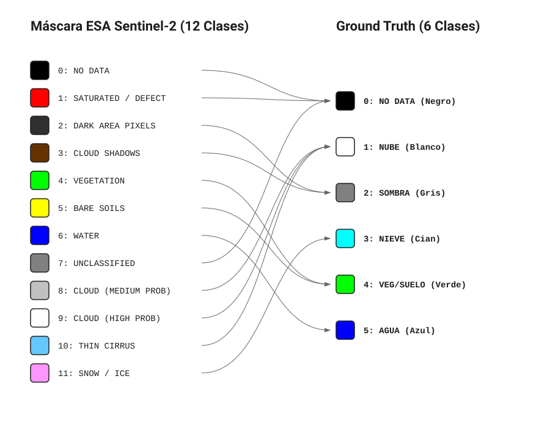
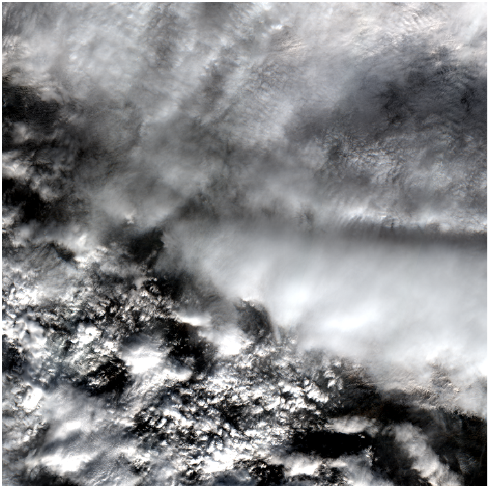

# Legendado Categórico y Estrategia de Agrupación Espacial (SCL)

Este documento justifica el esquema teórico y la estructuración del *Feature Engineering* aplicado a las máscaras de segmentación nativas de Sentinel-2 (*Scene Classification Layer* - SCL) para el adiestramiento y calibración de la arquitectura neuronal U-Net.

## 1. El Estándar Semántico de Sen2Cor (Las 12 Clases Iniciales)

El módulo oficial estandarizado por la ESA (Sen2Cor) genera una matriz de validación (*Ground Truth*) paramétrica que segrega el dominio territorial en 12 categorías discretas (escalas 0 a 11).

| Escala | Categorial Sen2Cor | Justificación Descriptiva |
| :---: | :--- | :--- |
| 0 | No Data | Regiones nulas fuera del perímetro de barrido del sensor espacial. |
| 1 | Saturated / Defective | Píxeles cegados por reflectancia extrema (saturación paramétrica). |
| 2 | Dark Area Pixels | Dominios de muy baja reflectancia (densidad forestal, sombras topográficas escarpadas). |
| 3 | Cloud Shadows | Proyección del oscurecimiento derivado de cuerpos nubosos convectivos o laminares. |
| 4 | Vegetation | Cobertura edáfica con trazas de clorofila activa (biomasa silvestre y agrícola). |
| 5 | Not Vegetated | Cobertura desprovista de biomasa (geología desnuda, pavimentación, tejidos urbanos). |
| 6 | Water | Dominios pelágicos, cursos hídricos y cuencas lacustres de alta profundidad. |
| 7 | Unclassified | Inviabilidad algorítmica de correlacionar el espectro del píxel con perfiles conocidos. |
| 8 | Cloud (Medium Probability) | Sistemas nubosos de transición (bruma, frentes de avance). |
| 9 | Cloud (High Probability) | Sistemas nubosos estructurales de alta albedo (cúmulos densos, desarrollos verticales). |
| 10 | Thin Cirrus | Formaciones atmosféricas de elevada altitud constituidas por partículas de hielo (Cirros). |
| 11 | Snow / Ice | Coberturas sólidas generadas por precipitación nival o casquetes de hielo. |

## 2. Reducción de la Complejidad Dimensional (Colapso Físico a 6 Clases)

El procesamiento inferencial estructurado para discriminar un abanico de 12 clases, de las cuales un porcentaje mayoritario carece de impacto estadístico para la disociación nube-nieve, penalizaría severamente la capacidad de convergencia algorítmica.

Para mitigar esta ineficiencia latente, la rutina de ingesta ([`download_sentinel.py`](../scripts/download_sentinel.py)) ejecuta un colapso algebraico sistemático del archivo `SCL.jp2`, generando un documento matricial GeoTIFF (`SCL.tif`) que aglutina el espacio paramétrico en **6 Clases Maestras**. Este colapso optimiza y agiliza la revisión visual y las secuencias automatizadas de depuración del script [`004_create_dataset.py`](../scripts/004_create_dataset.py).

La transcripción estructural y su correlación cromática para entornos GIS queda definida bajo el siguiente esquema:

- **Clase 0 (Descarte):** [COLOR GIMP: Negro puro / `000000`] Aglutina los valores nativos [0, 1, 2, 7]. Segmentos sin validez analítica. Si un bloque matricial supera una concentración del 90% de este valor, el módulo [`004_create_dataset.py`](../scripts/004_create_dataset.py) lo suprime del flujo de almacenamiento. La arquitectura de *Deep Learning* ignorará estas coordenadas espaciales durante el adiestramiento (`ignore_index=0`).
- **Clase 1 (Suelo Analítico):** [COLOR GIMP: Verde Bosque / `228B22`] Aglutina [4, 5]. Agrupa la biomasa activa y los sustratos geológicos descubiertos.
- **Clase 2 (Nube):** [COLOR GIMP: Blanco puro / `FFFFFF`] Aglutina [8, 9, 10]. Engloba todo el espectro de obstrucción atmosférica altamente reflectante.
- **Clase 3 (Sombra Proyectada Nube):** [COLOR GIMP: Gris / `646464`] Preserva el valor [3]. Dominios terrestres oscurecidos por interferencia meteorológica.
- **Clase 4 (Nieve):** [COLOR GIMP: Cyan Brillante / `00FFFF`] Preserva el valor [11]. El objetivo matriz de control y segmentación del proyecto.
- **Clase 5 (Dominios Hídricos):** [COLOR GIMP: Azul Puro / `0000FF`] Preserva el valor [6]. Masas de agua pelágicas e interiores. Su aislamiento algorítmico previene la asignación probabilística errónea inducida por reflejos solares direccionales (*Sun Glint*).

## 3. Justificación de la Arquitectura de Agrupación

### 3.1. Simplificación Atmosférica (8, 9, 10 -> Clase 2)
Dentro del ámbito de la teledetección operativa (Cálculo NDVI, perfiles de deforestación), un píxel corrompido por la interferencia de un cirro tenue (10) asume el mismo grado de invalidez instrumental que aquel tapado por un sistema cumulonimbo (9). El paradigma binario esencial cuestiona la validez visual del píxel frente al suelo. Al colapsar las variables nubosas, se simplifica radicalmente la dimensionalidad del espacio latente que la topología U-Net debe correlacionar, optimizando dramáticamente la aceleración convexa de la red.

### 3.2. Prevención de Ruido Categórico (Separación Nube y Sombra)
Podría formularse la unificación taxonómica de las clases "Sombra" y "Nube" bajo una macrorregión de "Interferencia Meteorológica". No obstante, la transposición de esta filosofía al campo de las Redes Convolucionales constituye un anti-patrón de diseño crítico.

- **Dualidad Espectral:** La formación nubosa exhibe reflectancias exponenciales (señales saturadas en el espacio visible). La sombra, contrariamente, desencadena la atenuación radiométrica extrema (sumidero paramétrico).
- **El Problema Latente:** Si se fuerza a la arquitectura a indexar valores matemáticos de magnitudes diametralmente opuestas bajo una etiqueta semántica unificada, el modelo neuronal incurrirá en inestabilidad algorítmica (imposibilidad de hallar el límite convectivo entre blancos y negros). Esto hundiría las métricas de precisión global.
- **Estrategia Divisoria:** Se decreta la separación categórica inquebrantable de la Clase 2 (Nubes) y la Clase 3 (Sombras) a lo largo de las fases de entrenamiento. Con este aislamiento, el algoritmo mapea las leyes físicas con alta pureza. En fase de Producción (Inferencia), el *backend* del visor GIS asume la unificación programática de ambas etiquetas para su eliminación gráfica conjunta, externalizando el esfuerzo heurístico fuera de la IA.

## 4. Fenómenos Excepcionales: Sombras Superpuestas (Sistema "Mar de Nubes")

Durante el protocolo de revisión visual y edición de la máscara SCL, se constata recurrentemente la aparición de estratos nubosos de alta densidad, caracterizados por texturas orográficas severas, como denota el siguiente mapeo espacial:

### 4.1. Falsos Positivos Topológicos de Sen2Cor
El algoritmo de base de la ESA carece de noción de volumen atmosférico. Al intersectar un sistema nuboso alto con una formación estratificada inferior, el sistema procesa una caída de reflectancia inmediatamente adyacente a un foco de alta reflectancia. Condicionado por estimadores geométricos y la elevación cenital, Sen2Cor infiere heurísticamente la presencia de un elemento terrestre oscurecido, etiquetando la depresión nubosa como **Sombra de Nube (3)**, cuando su verdadera naturaleza es hidrometeorológica.

### 4.2. Tratamiento Metodológico
Ante estas disfunciones categóricas (paneles geográficos con 100% de cobertura y nula percepción terrestre), se estipulan dos vectores metodológicos:
1. **Opción Conservadora (Pauta Estándar):** Preservar la clasificación originaria de Sen2Cor como **Sombra de Nube (3)**. La topología convolucional interiorizará dichas geometrías limítrofes oscuras como perfiles de sombra. Dado que el post-procesamiento de Inferencia unifica y elimina nubes y sombras simultáneamente, la resolución de negocio será matemáticamente correcta.
2. **Opción Restitutiva:** Intervención manual exhaustiva sobre la cartografía y recategorización cromática como **Nube (2)**.

Se adopta la vía conservadora como directriz operativa para el entrenamiento basal del modelo, con el objetivo de optimizar recursos del equipo de datos, reservando la auditoría e intervención manual intensiva exclusivamente para subsanar deficiencias de alto impacto estructural: **reclasificación de formaciones nivales bajo el umbral de nubes, o falsos positivos atmosféricos proyectados sobre polígonos industriales y litorales**.

### 4.3. Restricciones Analíticas sobre los Datos de Test
Es prioritario destacar que la flexibilidad tolerada bajo la estrategia previa queda suprimida categóricamente al operar sobre el conjunto de evaluación constituido por los 10 gránulos de Test ([`test_granules.csv`](../scripts/test_granules.csv)).

En la fase de depuración de este subconjunto ciego, la intervención metodológica no contempla la más mínima tolerancia analítica; resulta fundamental la ejecución de un etiquetado paramétrico perfecto. Si el proceso adolece de rigor, la precisión inferencial (IoU) de la U-Net sería contrastada frente a los propios errores geométricos del algoritmo Sen2Cor. Ello desencadenaría una alteración engañosa de los indicadores estadísticos, deprimiendo falsamente la tasa de aciertos de la arquitectura en los dominios nivales donde precisamente demuestra superioridad técnica. Consecuentemente, el vector "restitutivo" debe aplicarse sistemáticamente a la totalidad de gránulos designados como barrera validadora (Edición *Pixel-Perfect* del *Ground Truth*).
