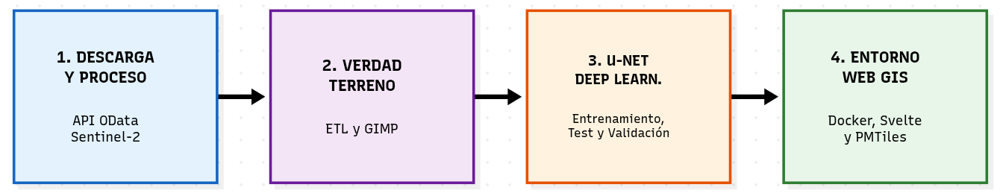
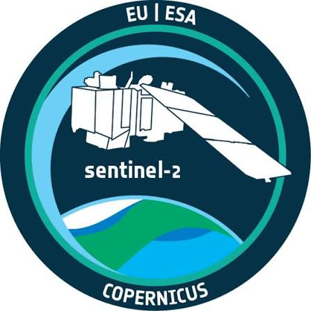
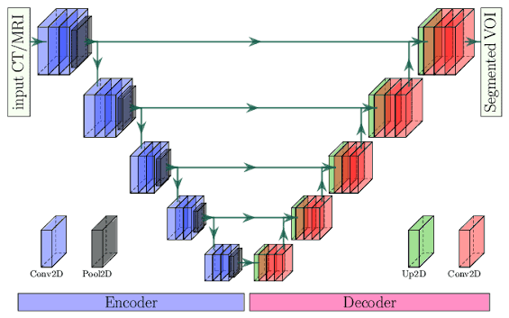

# Estructura de Diapositivas - Presentación TFB

*Regla de oro: Poco texto. El protagonista de la PPT eres tú y las imágenes.*

## 1. Portada
- **Título:** Desarrollo de un entorno GIS modular con IA y Web GIS
- **Autor:** Antonio López
- **Tutor:** Favela Natalie Quintero Chona
 

## 3. El Objetivo del Proyecto
- **Objetivo Real:** Creación de una arquitectura (pipeline) modular, agnóstica y escalable para proyectos GIS.
- **El Caso de Uso (Validación):** 
  - Entrenamiento de un modelo U-Net para detección de nubes en Cataluña usando Sentinel-2.

## 4. Metodología: Arquitectura del Pipeline

## 5. Fase 1: Descarga y Proceso
- Automatización de peticiones a la API OData CDSE.
- Descarga y filtrado de bandas ópticas puras y espectro infrarrojo (Sentinel-2).
- Optimización de almacenamiento con entornos virtuales ligeros (VRT).

## 6. Fase 2: Verdad Terreno (ETL y GIMP)
- Mapeo de la clasificación original de 12 clases a 6 "Clases Maestras".
- Limpieza y corrección visual meticulosa usando capas en GIMP.

## 7. Fase 3: U-NET Deep Learning
- Red neuronal convolucional programada desde cero en PyTorch.
- Procesamiento espacial particionado (Tiling) para evitar colapso de RAM.

## 8. Fase 4: Entorno Web GIS
- Transformación de inferencias a formato PMTiles.
- Frameworks y librerias web cartograficas (Svelte + MapLibre GL).
- Empaquetado y despliegue con contenedores Docker.

## 9. Resultados: Métricas del Modelo
- **IoU Nieve:** 84.64% | **Recall Nieve:** 93.72%
- **Precisión Suelo:** 95.17%

## 10. Discusión Crítica (Limitaciones)
- Falta del Modelo Digital de Elevación (DEM): causa confusión en sombras montañosas.
- Cuello de botella humano: crear la Verdad Terreno a mano no es escalable.

## 11. Futuras Líneas de Investigación
- Inyección de altimetría (DEM de Cataluña).
- Servidor reescrito en **Rust** para procesamiento rápido y bajo demanda.
- IA Multimodal (PaliGemma) para corregir píxeles de forma automática.
- Usar modelos preentrenados como CloudSen12.

## 12. Viabilidad y Sostenibilidad
- Filosofía 100% *Open Source* y replicabilidad científica.
- Alineación directa con Agenda 2030 (ODS: Industria, Innovación y Acción por el Clima).
- Códigos UNESCO (Aprendizaje Automático y Cloud Computing).
- **[Imagen]** Logos de los ODS y de GitHub.

## 13. Conclusiones Finales
- Demostración empírica de la viabilidad de un *pipeline* geoespacial integral.
- Éxito al conectar satélites crudos con Deep Learning y Web GIS.

## 14. Cierre
- Gracias por su atención.
- Turno de preguntas.

