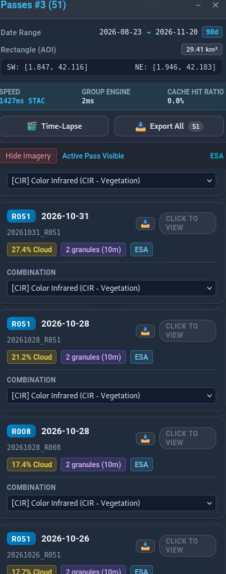
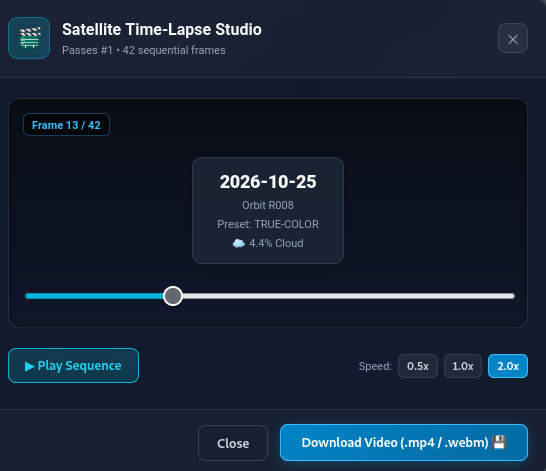

# Rust SCL Exact Clouds

## Index

1. [The Problem: False Scene Averages vs AOI Clouds](#1-the-problem-false-scene-averages-vs-aoi-clouds)
2. [Rust SCL Exact Cloud Engine Pipeline](#2-rust-scl-exact-cloud-engine-pipeline)
3. [SCL Classification Classes and Formula](#3-scl-classification-classes-and-formula)
4. [Dual-Badge UI and User Guidance](#4-dual-badge-ui-and-user-guidance)
5. [Next steps](#5-next-steps)

---

## 1 The Problem: False Scene Averages vs AOI Clouds

- ***Metadata Fallacy***: Standard STAC and Copernicus catalog metadata reports `cloud_cover` averaged across an entire 100x100 km satellite scene (10,000 km²).
- ***The Dilemma***:
    - A satellite scene might have 85% cloud coverage over mountain ranges, but the specific lake or reservoir in the valley is completely clear (0% cloud).
    - If a user sets a cloud filter of 20%, valuable clear observations are discarded.
    - Conversely, a scene with only 5% clouds might have that single cloud directly covering the lake.
- ***The Solution***: Compute the true cloud percentage **strictly inside the user's drawn Area of Interest (AOI)** by scanning native 20m Scene Classification Layer (SCL) rasters in parallel.
- ***Visuals***:
    
- ***File References***:
    - Pass Card UI: [PassCard.svelte](../src/components/PassCard.svelte)
    - Rust Implementation: [processor.rs](../../008_water_quality_api_rust/src/processor.rs)

[←Index](#index)

## 2 Rust SCL Exact Cloud Engine Pipeline

- ***Microservice Endpoint***: `POST /api/passes/exact-clouds` in [main.rs](../../008_water_quality_api_rust/src/main.rs).
- ***Payload Contract***:
  ```json
  {
    "passes": [
      { "id": "2026-08-15-orbit-65", "scl_url": "https://sentinel-cogs.s3.amazonaws.com/.../SCL.tif" }
    ],
    "polygon": [[2.15, 41.38], [2.18, 41.38], [2.18, 41.40], [2.15, 41.40], [2.15, 41.38]]
  }
  ```
- ***High-Throughput Parallelism***:
    - Implemented in [processor.rs](../../008_water_quality_api_rust/src/processor.rs) using **Rayon** (`par_iter`).
    - Uses GDAL `/vsicurl/` HTTP range requests to read only the specific GeoTIFF tile blocks overlapping the AOI polygon, skipping gigabytes of unneeded pixels.
    - Evaluates pixel coordinates against the polygon boundary using a fast Ray-Casting algorithm (`point_in_polygon`).
- ***Execution Time***: ~1.5 to 2.5 seconds total for an entire 90-day time series.
- ***File References***:
    - Endpoint Controller: [main.rs](../../008_water_quality_api_rust/src/main.rs)
    - Raster Engine: [processor.rs](../../008_water_quality_api_rust/src/processor.rs)

[←Index](#index)

## 3 SCL Classification Classes and Formula

- ***ESA Scene Classification Layer (SCL) Schema***:
    - Class 0: NO_DATA
    - Class 1: SATURATED_OR_DEFECTIVE
    - Class 2: DARK_AREA_PIXELS
    - **Class 3: CLOUD_SHADOWS** *(Counted as cloud obstruction)*
    - Class 4: VEGETATION
    - Class 5: NOT_VEGETATED
    - Class 6: WATER
    - Class 7: UNCLASSIFIED
    - **Class 8: CLOUD_MEDIUM_PROBABILITY** *(Counted as cloud obstruction)*
    - **Class 9: CLOUD_HIGH_PROBABILITY** *(Counted as cloud obstruction)*
    - **Class 10: THIN_CIRRUS** *(Counted as cloud obstruction)*
    - **Class 11: SNOW_OR_ICE** *(Counted as cloud obstruction)*
- ***Mathematical Formula***:
  $$\text{AOI Cloud Cover } (\%) = \left( \frac{\sum \text{Pixels}_{\{3, 8, 9, 10, 11\}}}{\sum \text{Total Pixels inside AOI Polygon}} \right) \times 100$$
- ***File References***:
    - Classification Logic: [processor.rs](../../008_water_quality_api_rust/src/processor.rs)

[←Index](#index)

## 4 Dual-Badge UI and User Guidance

- ***Dual Badge Display ([src/components/PassCard.svelte](../src/components/PassCard.svelte))***:
    - Every pass card displays two complementary badges:
        - `☁️ X.X% AOI`: Exact scientific cloud percentage inside the user's drawn boundary.
        - `Y.Y% Scene`: Standard whole-scene catalog metadata.
- ***Default 100% Slider Rule ([src/components/ControlPanel.svelte](../src/components/ControlPanel.svelte))***:
    - Default cloud cover slider is set to **100%** to guarantee zero missed acquisition dates.
    - Even with the slider at 100%, the Rust SCL scan calculates and displays exact `aoiCloudCover` for all cards.
    - When the slider is adjusted below 100%, passes with `aoiCloudCover > maxCloudCover` are filtered out.
- ***Scientific Info Modal***:
    - An `[ ℹ️ ]` button in [ControlPanel.svelte](../src/components/ControlPanel.svelte) opens a glassmorphism modal detailing the ESA SCL methodology and estimated scan duration (~1.5–2.5s).
- ***Visuals***:
    
- ***File References***:
    - Control Panel: [ControlPanel.svelte](../src/components/ControlPanel.svelte)
    - Pass Card: [PassCard.svelte](../src/components/PassCard.svelte)

[←Index](#index)

## 5 Next steps

- [006 Export and Timelapse](./006_export_and_timelapse.md)
- [007 CI/CD and Deployment](./007_ci_cd_and_deployment.md)
