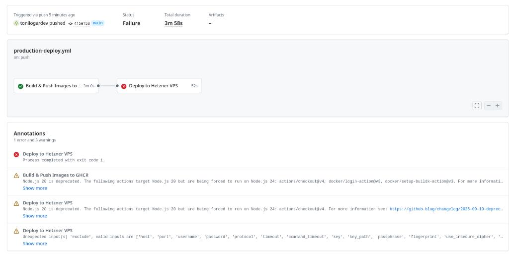

# Export and Timelapse

## Index

1. [High-Resolution Image Export Workflow](#1-high-resolution-image-export-workflow)
2. [Animated Timelapse Engine](#2-animated-timelapse-engine)
3. [Next steps](#3-next-steps)

---

## 1 High-Resolution Image Export Workflow

- ***Service Overview ([src/lib/services/ImageExportService.ts](../src/lib/services/ImageExportService.ts))***:
    - Exports user-selected satellite passes stitched into seamless, high-resolution PNG or GeoTIFF files without screen resolution limitations.
- ***Mathematical Projection***:
    - Converts WGS84 coordinates ($EPSG:4326$) to Web Mercator ($EPSG:3857$) tile coordinates.
    - Employs `calculateOptimalZoom()` to select an optimal zoom level targeting between 4 and 25 tiles to guarantee high detail without browser memory crashing.
- ***Compositing Pipeline***:
    - Fetches the constituent tiles in parallel.
    - Draws them onto an off-screen HTML5 `<canvas>`.
    - If a polygon AOI is active, clips the perimeter using canvas blending (`globalCompositeOperation = 'destination-in'`).
    - Appends scientific metadata headers (Acquisition Date, Mission Sentinel-2, Orbit, AOI Cloud %, Spectral Index).
- ***UI Modal ([src/components/ExportModal.svelte](../src/components/ExportModal.svelte))***:
    - Allows configuring format (PNG, GeoTIFF), inclusion of boundary vectors, and resolution scale.
- ***File References***:
    - Export Logic: [ImageExportService.ts](../src/lib/services/ImageExportService.ts)
    - Export Modal: [ExportModal.svelte](../src/components/ExportModal.svelte)

[←Index](#index)

## 2 Animated Timelapse Engine

- ***Engine Overview ([src/components/TimelapseModal.svelte](../src/components/TimelapseModal.svelte))***:
    - Transforms chronological satellite passes into an interactive animated timelapse player.
    - Enables visual analysis of algal blooms, seasonal reservoir drying, sediment plumes, or shoreline shifts over time.
- ***Key Controls***:
    - **Play / Pause / Step**: Frame-by-frame forward and reverse stepping.
    - **Speed Control**: Adjustable playback speed (100ms to 2000ms per frame).
    - **Spectral Index Selector**: Change visualization mode (True Color RGB, False Color, NDVI, MNDWI, NDTI) on the fly across the entire timelapse.
    - **Scrubber Bar**: Click-to-seek temporal slider with acquisition date and cloud percentage indicators.
- ***Visuals***:
    
- ***File References***:
    - Timelapse Component: [TimelapseModal.svelte](../src/components/TimelapseModal.svelte)
    - State Store: [store.svelte.ts](../src/lib/store.svelte.ts)

[←Index](#index)

## 3 Next steps

- [07 CI/CD and Deployment](./07_ci_cd_and_deployment.md)
- [00 Master Index](./00_master_index.md)
