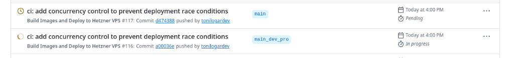

# CI/CD and Deployment

## Index

1. [Docker Containerization and Multi-Stage Builds](#1-docker-containerization-and-multi-stage-builds)
2. [Traefik Reverse Proxy and Production Routing](#2-traefik-reverse-proxy-and-production-routing)
3. [GitHub Actions CI/CD Pipeline](#3-github-actions-cicd-pipeline)
4. [Standing Developer Constraints and Safeguards](#4-standing-developer-constraints-and-safeguards)
5. [Next steps](#5-next-steps)

---

## 1 Docker Containerization and Multi-Stage Builds

- ***Multi-Stage Strategy ([Dockerfile](../Dockerfile))***:
    - **Stage 1 (Build)**: `node:22-alpine` installs dependencies and executes `npm run build` using Vite.
    - **Stage 2 (Runtime)**: Minimal `nginx:alpine` image hosting static compiled assets from `/app/dist`.
    - **SPA Fallback**: Configures Nginx with `try_files $uri $uri/ /index.html;` to preserve client-side routing.
    - Resulting container image size is minimal (<30 MB uncompressed).
- ***Local Build and Test Commands***:
  ```bash
  cd 012_base_project
  docker build -t sentinel-viewer:local .
  docker run -p 8080:80 sentinel-viewer:local
  ```
- ***File References***:
    - Container Spec: [Dockerfile](../Dockerfile)
    - Orchestration File: [docker-compose.yml](../../docker-compose.yml)

[←Index](#index)

## 2 Traefik Reverse Proxy and Production Routing

- ***Reverse Proxy Ingress ([docker-compose.yml](../../docker-compose.yml))***:
    - Traefik v2.11 handles automatic HTTPS Let's Encrypt certificates, HTTP-to-HTTPS redirects, and domain-based routing.
- ***Routing Rules***:
    - `sentinel-viewer`: Listens on `Host('sentinel.${DOMAIN_NAME}')` routing port 80.
    - `water-quality-api`: Listens on `Host('water-api.${DOMAIN_NAME}')` routing port 8000.
    - Traefik communicates across the shared internal bridge network `traefik-net`.
- ***File References***:
    - Docker Compose: [docker-compose.yml](../../docker-compose.yml)
    - Rust API: [main.rs](../../008_water_quality_api_rust/src/main.rs)

[←Index](#index)

## 3 GitHub Actions CI/CD Pipeline

- ***Workflow Definition ([.github/workflows/production-deploy.yml](../../.github/workflows/production-deploy.yml))***:
    - **Trigger**: Pushes to `main` and `main_dev_pro` branches, plus manual `workflow_dispatch`.
- ***Concurrency Protection***:
  ```yaml
  concurrency:
    group: production-deploy
    cancel-in-progress: false
  ```
  - Queues successive deployments safely without killing in-flight builds or causing Docker daemon locks on the Hetzner VPS.
- ***Pipeline Stages***:
    1. **Build & Push Images to GHCR**:
        - Authenticates against GitHub Container Registry (`ghcr.io`).
        - Injects production `.env` variables from GitHub Secrets (`PROD_ENV_FILE`).
        - Runs `docker compose build` and `docker compose push`.
    2. **Deploy to Hetzner VPS**:
        - Transfers orchestration files to `/opt/gis_platform` using `appleboy/scp-action`.
        - Executes remote SSH commands: `docker compose pull`, `docker compose up -d --remove-orphans`, and `docker image prune -f`.
- ***Visuals***:
    
- ***File References***:
    - Workflow File: [production-deploy.yml](../../.github/workflows/production-deploy.yml)

[←Index](#index)

## 4 Standing Developer Constraints and Safeguards

- ***Rule 1: Never Push Without Explicit User Order***:
    - Under no circumstances run `git push` unless the user explicitly requests it in the immediate prompt.
    - Keep commits local (`git commit`) until instructed to publish.
- ***Rule 2: English Coaching Standard***:
    - Always provide a friendly, constructive B1/B2 English coaching tip in every response turn.
- ***Rule 3: Scientific Rigor ("Dato Mata Relato")***:
    - Maintain exact pixel classification precision. Never estimate or guess SCL numbers; always compute them via the Rust microservice.
- ***Rule 4: Sandbox File Permissions***:
    - In sandboxed execution environments, git lock files (`.git/index.lock`) require user approval (`BypassSandbox: true`) with consistent tool summaries.
- ***File References***:
    - Git History: [git log](../../.git/)
    - Documentation Skill: [.agents/skills/documentation/SKILL.md](../../.agents/skills/documentation/SKILL.md)

[←Index](#index)

## 5 Next steps

- [00 Master Index](./00_master_index.md)
- [01 System Architecture](./01_system_architecture.md)
